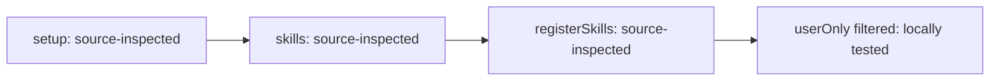

# Engineering research — acceptance test evidence

Tried on 2026-11-08, in a clean copy of the project at b29db7155edf059c93bd5869b98a8f34f85284bb.

## Environment and procedure

- Independent acceptance witness; did not implement or repair this change.
- Source: /private/tmp/loom-engineering-research-delivery.
- Fresh clone: /private/tmp/engineering-research-acceptance-final-20261108.
- Lifecycle fixture: /private/tmp/engineering-research-preservation-fixture-20261108/project.
- Exact setup commands:
  `git clone --no-hardlinks --no-checkout /private/tmp/loom-engineering-research-delivery /private/tmp/engineering-research-acceptance-final-20261108`
  `git -C /private/tmp/engineering-research-acceptance-final-20261108 checkout --detach b29db7155edf059c93bd5869b98a8f34f85284bb`
- Observed clean tracked tree before work: `git status --porcelain` returned nothing; `git rev-parse HEAD` returned the tested SHA.
- Read confirmed intent, spec including requirements/design decisions/UI-flows, plan, root README setup/development and KICKOFF-DEFAULTS. Engineering change: spec says UI flows N/A.
- Explicitly read the delivered SKILL.md, research-methods, source-policy, evaluation-selection, structured-relations, preservation and research template before corresponding new substantive investigation.
- The behavioral actor is this fresh native acceptance agent following the raw delivered skill. These are explicit-load exercises, NOT new blind routing/CLI-model runs, installed-plugin sessions or independent evidence of general reliability.
- All research exercises wrote only new scratch records in the clean clone. Actual substantive `cat` readbacks were returned by the tool after each save/update; checks did not rely on header/hash/existence alone.
- No external model/network calls, actual Vault discovery, global install/config edits, publication, or commits to the delivery repository occurred.

README development checks, executed from clean clone:
```text
python3 scripts/sync_codex_manifests.py --check --all
python3 scripts/check_plugin_boundaries.py loom-code
python3 scripts/check_plugin_boundaries.py loom-design
python3 loom-code/scripts/check-skill-crossrefs.py

[sync check exited 0, no text]
OK: loom-code is filesystem-boundary clean.
OK: loom-design is filesystem-boundary clean.
OK: all relative skill cross-references resolve.
```

Initial isolated-test setup failed because uv could not create a cache temporary file in the default cache (Operation not permitted). Retrying with a NEW temporary cache and offline mode failed because execnet was absent. These were real setup failures, not test results. The same authorized focused command then ran with sandbox-approved existing-cache access:
```sh
uv run --isolated --with-requirements requirements-package-tests.lock python -m pytest loom-code/tests/engineering-research/test_package.py loom-code/tests/test_opencode_loader.py tests/test_loom_skill_description_catalog.py -q
```
Actual output: `31 passed in 3.32s`. No source repair or global package installation.

The README installation instructions use marketplace/global host installs. Those were read, not executed because existing installations are outside this test's authorization. Isolated source loading is covered below; installed-host parity is not.

Full package suite was intentionally NOT executed by this witness, per acceptance-tester step 6, and is NOT skipped by the workflow. Its required finalization command is:
`uv run --isolated --with-requirements requirements-package-tests.lock python scripts/run_package_tests.py --loom-family -q`.
The automated suite runs before acceptance and blocks it on failure. Prior Build suite results supplied by the caller are not substituted for these behavioral observations.

## 1. 正式 loom-code 可發現並使用 engineering-research；loom-design 不直接引用或引導至此技能，既有 Loom 任務仍可在未使用此能力時正常進行。

- How tried: focused package invariants; actual Node loader setup through existing test harness; explicitly read the registered source skill and follow it in sections 3–7.
- Named tests: `test_skills_registered_plugin_qualified` checks actual loader registrations/content for all three plugins; `test_code_owns_the_only_discoverable_package_without_design_routing`; `test_code_stations_delegate_research_to_their_bundled_skill`; existing router/command/agent/hook tests in the same focused file.
- What came back: all 31 focused tests passed. Code owns the sole package, design skill files do not reference it, and existing unrelated commands/hook behavior remain testable without invoking research.
- Boundary: the Node context is stubbed, but the actual delivered index.js and loader execute. This proves isolated source registration and usage, not an installed OpenCode/Codex/Claude/Antigravity session. No global install was attempted.

## 2. 在代表性工程證據缺口與一般查詢中，研究能力能按問題的重要性適當使用，保留原任務的目標與授權範圍。

- Explicit case input: “Can the delivered loader expose the code-owned research skill? Resolve this before deciding whether the caller can use it; do not install or publish.”
- Native actor selected direct inspection plus smallest existing loader test; retained the record and returned source-loader capability and remaining installed-host uncertainty to the original decision.
- Ordinary comparison input: “Python list length syntax only.” Actual answer retained in the actor exercise: `len(items)`. No extra question-specific research note or new goal was created for that routine lookup.
- Evidence in scratch `docs/loom/acceptance-fixture/research/02-optional-handoff.md` records this selection and the caller scope; no goal tool/install/publication was invoked.
- Result partly: this observed explicit native exercise preserves scope, but it is not a blinded model choice. The archived historical discovery benchmark is separate; current automatic selection probability was not remeasured.

## 3. 研究能核對前提及適用條件，對結論提供可回查的證據，並區分來源推論、實際執行與尚未驗證的聲明；所聲稱的研究產物可實際核對。

- Actor question: source-loader exposure was distinguished from “already installed and usable everywhere.”
- Read actual `loom-code/index.js`, `loom-code/opencode/loader.js` lines 20–155, applicable metadata filtering and existing loader assertions. Setup calls skills → parsing → registerSkills; model-invocation exclusion changes the claim.
- Measured result is only the actual 31-test run, not hypothetical CI/deployment.
- Created `docs/loom/acceptance-fixture/research/01-loader-capability.md` using apply_patch. Actual full-body readback via `cat` returned question/scope, method, observed test result, source-supported registration, inference, unknown installed hosts, evidence links and limits.
- Representative saved wording:
  “Observed: the focused package/loader/catalog run passed 31 tests.”
  “Inference: callers can resolve this source-owned entry under the tested loader interface.”
  “Unknown: user-installed host caches and automatic agent selection.”
- Actual local-link resolution subsequently checked all 11 targets across the four saved records. No inaccessible URL was represented as inspected.

## 4. 工程評估能按問題選用合適方法；單純問題可直接查證，混合問題可使用必要的互補方法，不強制套用全部框架、工具或來源。

- Direct case: loader capability above. A named framework was omitted; source path and focused run answered the bounded question.
- Mixed evaluation input: “Compare optional evidence handoff with a mandatory research station under the established no-new-station constraint; inspect whether existing callers actually return to their task. Do not implement.”
- Read evaluation-selection first. Chose a lightweight trade study for alternatives and connected caller inspection for the distinct integration gap. Compared against a mandatory constraint, not invented weighted scores. Mandatory station fails the given constraint; optional handoff fits.
- Read actual Build scope paragraph (lines 18–24), Write-plan research paragraph near 360 and code router table/boundary.
- Created and fully read `02-optional-handoff.md`. It states criteria, evidence, decision impact and what would reopen the decision. No profiling, outside search, quotas or unrelated frameworks were used.
- Boundary: representative policy assessment, not measured latency savings, industry prevalence, formal ATAM or causal agent-quality improvement. The actor evaluated actual integration text, not a production deployment.

## 5. 每個獨立研究問題有可追溯的 Markdown 紀錄，具備 frontmatter 並可供 Obsidian 與一般 Markdown 工具閱讀；延續研究與條件改變後的重新驗證能保留原有依據。

Actual scratch records:
1. `docs/loom/acceptance-fixture/research/01-loader-capability.md`
2. `docs/loom/acceptance-fixture/research/02-optional-handoff.md`
3. `docs/loom/acceptance-fixture/research/03-loader-disabled-revalidation.md`
4. `docs/loom/research/2026-11-08-acceptance-standalone.md`

- Same-question continuation: apply_patch appended the qualifying exclusion observation to 01, retaining original finding/evidence and `created: 2026-11-08`.
- Materially different condition: 03 separately answers visibility when user-only metadata is true, citing the actual executed exclusion fixture. It links 01 and does not overwrite it. This condition belongs to the isolated test plugin, not a change to production engineering-research metadata.
- Hash of 01 after continuation: `7ff2c45bdf77641d053a3f1b9d9575a68f5bc2066f9e3edb1baa3df40b47c1ef`. Rechecked after revalidation/diagram and still identical.
- Standalone record has no `change` field and required no new intent/goal.
- Full content was read after each save/update, including the final graph addition.
- Actual YAML parser: `uv run --isolated --with-requirements requirements-package-tests.lock python -c <validation>`, with yaml.safe_load on each saved frontmatter; assert required keys, type/tag, no nested mappings; resolve standard Markdown relative targets from saved directory.
- Output: `YAML parsed: 4 flat records; local evidence links resolved: 11`.
- Validation code actually executed by the isolated Python command (run from the scratch clone):
```python
from pathlib import Path
import yaml, re
files = list(Path("docs/loom/acceptance-fixture/research").glob("*.md")) + [
    Path("docs/loom/research/2026-11-08-acceptance-standalone.md")
]
n = 0
for p in files:
    t = p.read_text()
    m = yaml.safe_load(t.split("---", 2)[1])
    assert all(k in m for k in ("title", "type", "status", "created", "updated", "tags"))
    assert m["type"] == "loom-research" and "loom/research" in m["tags"]
    assert all(not isinstance(v, dict) for v in m.values())
    for x in re.findall(r"\[[^\]]+\]\(([^)]+)\)", t):
        assert (p.parent / x).resolve().is_file(), (p, x)
        n += 1
print("YAML parsed: 4 flat records; local evidence links resolved:", n)
```
- Records use ordinary Markdown body plus flat YAML, checked as text and parsed; Obsidian GUI rendering was not tested. Scratch notes were not copied into the maintained repository as executable fixtures.

## 6. 禁止寫入或無法保存時，提供明確標示的未儲存研究內容，不誤稱已產生保存文件。

- Case-specific input condition: prohibit project research writes for this case; expected missing path `docs/loom/research/no-write-case.md`.
- Actual actor output via tool text:
  “A6 explicitly unsaved draft — no project research artifact created: Question: can this no-write investigation claim a saved note? Conditions: the case forbids project writes. Method: reuse the already-read current skill rule. Finding: no; evidence may be returned in conversation, but the requested research artifact is missing. Decision: return to the requesting task without a saved path. Limits: unavailable writer branch is not runtime-induced here. This draft has NOT been saved as a research note.”
- Actual existence check output: `no-write research artifact exists: False`.
- No write request was made for that research artifact. Witness evidence of the draft is not represented as a saved research document.
- Boundary: explicit prohibition exercised; a real writer failure for this research path was not induced. The uv cache denial is an environment setup observation, not falsely reused as a failed research save.

## 7. GitHub／GitLab 實作行為的研究會檢查相關原始碼與相連條件；結構圖按需使用，其關係與不確定性不會取代證據或被誤稱為已驗證因果。

- Inspected genuine delivered repository source beyond README: entry import/setup, metadata parser including block descriptions, directory scan, userOnly condition and registerSkills filter. Existing Node tests actually exercise this implementation.
- Read `test_disable_model_invocation_read_case_insensitively_with_comment`: test creates a demo plugin, copies delivered loader, writes true-with-comment metadata and asserts actual registered model-skill list is empty. That named test passed in the 31-test run.
- Source question record initially needed no diagram. The changed-condition record gained a compact diagram because the connection/filter matters:

- Actual saved graph and adjacent words were read back after update. Arrows are explicitly “source-inferred calls/filtering, not causal performance effects”; nodes map to named functions/test. Text retains the answer without rendering.
- Boundary: actual source originated from the delivered Loom repository; no remote GitHub/GitLab fetch or installed release was claimed. No renderer was run, and GUI display/causal understanding is unverified. A parsed/rendered graph would not establish causal effects.

## 8. 在變更合併至 main 後，具有長期或跨專案價值的研究可獲得 Obsidian 保存提議；依賴釋出成立的內容須有相應釋出證據，未經當次明確授權不寫入 Vault，保存內容可回溯專案原始紀錄與版本。

- Created only a synthetic project research record under the lifecycle fixture, not a real Vault.
- Attempted literal Git lifecycle command included `git branch -d completed-research`. The host blocked the WHOLE initial command before execution with:
  `Command blocked by PreToolUse hook: BLOCKED by dcg`
  `Reason: git branch deletion requires explicit user approval.`
  Rule `core.git:branch-delete`.
- No alternate deletion syntax, environment override, manual ref edit or configuration change was attempted. The parent confirmed retaining this boundary.
- Executed remaining allowed lifecycle operations without the blocked deletion:
  `git init -b main project`;
  git add/commit of fixture research with command-local synthetic author and signing/hooks disabled for this fixture;
  `git switch -c completed-research`;
  `git commit --allow-empty -m 'fixture research change'`;
  `git switch main`;
  `git merge --no-ff completed-research -m 'fixture merged research'`.
- Actual merge observation:
  `2222eb381897caa888d9d75ff06ac732f8ce7a0e 2b105f24831b3e71b4030b59f5b9c24c80dbd8fe 2c228ee529feb1f873942c0196a55bd57b90a87d fixture merged research`.
  `git branch --merged` lists main and completed-research; status is clean; no release tags exist.
- Applied preservation rule: merge is observed, cleanup is NOT verified. Therefore defer proposal and copy; do not assert release-dependent claims; return without blocking the original research outcome. No consent was invented.
- `test ! -e fake-vault/research-copy.md` succeeded; no fake or real Vault note was written. Original source hash remains `f0463bdec9de2431d05682aad3333a29264d7ddb5395c93124902270c5f09bbc`.
- Result partly. Positive merge+cleanup+instance-consented-copy end-to-end path was not completed. CLI discovery, actual Vault, overwrites and application rendering remain untested.
- Historical F05/F06 saved-copy observations in the original/repair reports stay separate and retain their cleanup limitations; they are not combined with this run into an end-to-end pass.

## 9. 正式技能的載入、與原任務的銜接及上述研究行為有實際驗收證據；試驗稿、正式安裝及未驗證宿主的結果不混為同一項完成聲明。

- Current run: clean b29db7155edf059c93bd5869b98a8f34f85284bb, actual local Node loader, explicit native skill loading, bounded source decision/evaluation, actual records/full readbacks/link checks, no-write draft and actual merge/defer observations above.
- Handoff content returned to caller decision in 01/02: source-loader capability is established under tested interface; retain optional handoff; no new goal/install/publication/user checkpoint advancement; unresolved installed-host scope remains explicit.
- Historic records inspected by targeted search:
  `docs/skill-dogfood/2026-11-08-code-owned-engineering-research/report.md` (prior routing/explicit runs and cleanup limits),
  `repair-comparison.md` (F02 auditor disagreement and F03–F05 partial),
  `save-result-prototype.md` (test-tool intervention not general improvement; archived 11 runner sources).
- Those are historical results, not additional current acceptance runs. The saved-result helper is not formal runtime and no removed entrypoint was executed/restored.
- No automatic catalog selection rate, user-installed cache parity, Claude/Codex/Antigravity/OpenCode full-session parity, release/deployment or industry consensus is claimed.
- Final scratch tracked-tree check: `git diff --exit-code` exited 0; only four new scratch research files/directories are untracked. Exact HEAD remains b29db7155edf059c93bd5869b98a8f34f85284bb.
- Deliverable writes are only this evidence file and the acceptance report in the main worktree. No source or test repairs and no main-repository commits.

## Findings and boundaries

- Important validation gap at Acceptance 8: positive finishing lifecycle through successful cleanup and specifically consented copy is still not proven. Correct defer behavior is observed. Closing it requires a separately executable, authorized clean lifecycle test; old copy results plus this merge cannot close it.
- Acceptance 2 remains partly for current automatic selection; explicit native behavior and historical routing are different evidence.
- No production defect was inferred from a sandbox denial, a read-only source assertion or a prior partial outcome.
- No requested workflow step was skipped. Complete suite remains a separate required finalization check; it was not run by this witness. No important/fatal finding was supplied as dismissed by the parent.

