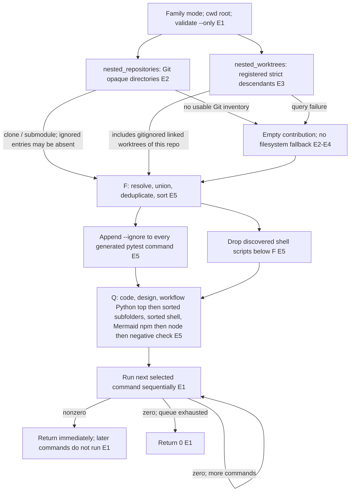

# Package runner exclusion design and failure order

## Question and scope

Should the package runner's exclusion design be retained? Investigate how
`--loom-family` excludes nested clones, submodules and gitignored linked
worktrees, and whether later groups execute after an earlier failure.

This is a source-only assessment of the four-file snapshot in `src/`, attributed
by [provenance.json](../../../provenance.json) to commit
`d5a7f0da247214bdb9c61fe90c550256432e5f76`. It is neither a full checkout nor
evidence of an installed or deployed version. The original repository path in
provenance was not accessed. No active change exists.

## Method and rationale

Inspect the runner entry point, connected Git helpers, and supplied test
definitions. This resolves the bounded implementation question without running
pytest, initializing Git, creating fixture repositories, installing dependencies,
using the network, or modifying supplied artifacts. Stop at the supplied source
boundary and distinguish command construction from actual collection behavior.

Read-only SHA256 verification with Python `hashlib.sha256(path.read_bytes())`
against `provenance.json` reported `MATCH` for all four source files and all five
bundled skill files. This verifies snapshot identity against the supplied
manifest, not the original repository or remote freshness.

## Findings

**The design combines two complementary Git inventories, then excludes their
resolved, deduplicated union from generated pytest and discovered shell commands.
The runner stops at the first failing command; subsequent groups do not run.**

1. `main` enters family mode only when the first argument is `--loom-family`.
   It uses the current working directory as the repository root. Missing or
   unknown `--only` values return 2. A valid `--only` selects one of the five
   groups; it does not change the inventory logic [E1].
2. `nested_repositories` uses `_git_entries`: check for a bare repository, require
   a Git top level, then run
   `git -C <root> ls-files --cached --others --exclude-standard -z`.
   Existing directory entries that are not symlinks become exclusions. This
   relies on Git collapsing a nested clone or submodule gitlink to an opaque
   entry instead of enumerating its contents. It does not search for `.git`
   markers. Symlink directories are deliberately omitted so resolving a symlink
   does not turn its target into a foreign exclusion [E2].
3. Because `--exclude-standard` hides ignored untracked entries, that inventory
   can miss a gitignored worktree. `nested_worktrees` independently runs
   `git -C <root> worktree list --porcelain -z`, parses `worktree ` fields, and
   keeps only paths strictly beneath the resolved root. It excludes neither the
   root itself nor outside siblings. This covers registered worktrees of the
   repository queried; it is not a global inventory of unrelated repositories
   [E3]. Both inventories use NUL-delimited output and `strip=False` to preserve
   path boundaries, including newlines [E2–E4].
4. `loom_family_commands` resolves both inventories, takes their set union, and
   sorts it. Every generated pytest command receives absolute `--ignore=<path>`
   arguments. Discovered shell scripts are omitted when their resolved parent
   chain contains an exclusion. Inventory building still uses filesystem
   `rglob`; it does not prune foreign trees during discovery. These controls
   affect collection/command selection, not the cost of traversing directories
   [E5].
5. The default command order is: **code → design → workflow Python top-level
   session → sorted workflow Python subfolder sessions → sorted shell scripts
   → Mermaid npm install → Node validation → negative shell check**. Optional
   Python sessions are emitted only when discovery finds matching test files.
   Code combines `tests` and `loom-code/tests` with `-n auto`; design has a
   separate session. Workflow top-level excludes the selected subfolders, which
   each get a separate session [E5].
6. `main` builds the command list, then calls `subprocess.call` sequentially.
   Any nonzero return immediately exits with that value. Failure within a
   workflow subfolder stops later subfolders and groups; failure of `npm ci`
   prevents both Mermaid checks. All commands succeeding returns 0. The ordinary
   `--then` mode also stops on its first failed pytest session, but it does not
   use the family exclusion machinery. Exceptions from starting a command are
   not caught here and also cannot lead to continuing the loop [E1].

## Evidence

All entries below are inspected local source at the manifest revision, not
runtime observations. Paths and line anchors refer to the supplied snapshot.

| ID | Source and anchors | What it supports |
|---|---|---|
| E1 | [runner](../../../src/scripts/run_package_tests.py#L153), lines 153–180; `split_groups`, lines 58–65 | Entry branch, `--only`, current-directory root, sequential execution, immediate failure return in both modes. |
| E2 | [repo_files](../../../src/loom-code/scripts/repo_files.py#L97), lines 97–146; ignored names, lines 59–61 and 171–172 | Opaque-directory inventory, symlink guard, bare/no-Git branches, Git listing flags, ignored path components. |
| E3 | [nested_worktrees](../../../src/loom-code/scripts/repo_files.py#L73), lines 73–94 | Independent worktree listing, strict descendant filter, empty list on failed query; docstring identifies Git >= 2.36 for NUL format. |
| E4 | [git_exec](../../../src/loom-code/scripts/git_exec.py#L50), lines 50–88 | `git -C`, UTF-8/surrogateescape handling, nonzero/OSError/timeout converted to `None` by default. |
| E5 | [command construction](../../../src/scripts/run_package_tests.py#L68), lines 68–150; roots, lines 51–55 | Discovery scope, local/node_modules rules, session ordering, foreign union, pytest ignores, shell filter and fixed Mermaid commands. |
| E6 | [test definitions](../../../src/tests/test_run_package_tests.py#L119), lines 119–184 and 314–331 | Definitions check worktree ignore tokens, real collect-only exclusion for a nested worktree and initialized nested repository, and omission of worktree/clone shell scripts. They were not executed here. |
| E7 | [ordering-related tests](../../../src/tests/test_run_package_tests.py#L22), lines 22–30, 76–84 and 260–277 | Definitions check later-group failure returns nonzero, Mermaid command order, and workflow session separation. The later-group test starts with a successful group; it does not verify that a failed first group prevents the second from running. |

The nested-clone test creates a committed nested Git repository with `git init`,
rather than invoking `git clone`. No supplied test directly exercises a
submodule, gitignored worktree, failed Git inventory, or first-failure prevention
of later commands. Implementation inspection supplies those conclusions or
identifies their limits; test names are not passing execution evidence.

## Structural relationships

Arrows below mean source-defined data flow or execution order, with branch labels
for conditions. Every relationship is source-supported, not measured. `F` is the
exclusion set; `Q` is the generated command queue.

`--only` filters groups in Q; empty Python sessions are omitted. Mermaid's three
fixed commands do not pass through the discovered-shell filter. Diagram branch
directions, order, and evidence mappings were manually checked against the
saved source and prose. No Mermaid parser or renderer was run; rendering remains
unverified.

## Decision impact

Retain the two-inventory union if the intended contract is Git-backed exclusion
of these foreign subtrees with sequential, stop-on-failure execution. Removing
the worktree inventory loses the explicit route for gitignored linked worktrees;
using only worktree registration loses the route for ordinary nested clones and
submodules. Per-command ignores keep the policy scoped to this runner instead
of adding repository-wide pytest configuration.

Do not treat this as a complete isolation guarantee. If the requirement is to
exclude all foreign repositories even when ignored or when Git fails, or to run
all groups despite failures, the current source does not meet that requirement.
Those would require a separate design decision and implementation work; none
was performed here.

## Limitations and open questions

- Git query failures are fail-open for exclusions: `run_git` defaults to `None`,
  and the helpers return empty contributions. Unlike `repository_files`,
  `nested_repositories` does not invoke `_walk_entries` as a fallback. Missing
  Git, refusal such as dubious ownership, or unsupported flags can therefore
  remove protection without stopping this runner. One working query can still
  contribute exclusions when the other fails [E2–E4].
- An ignored untracked clone, or a worktree belonging to an unrelated repository
  whose opaque entry is hidden, has no demonstrated route into the union.
  This is an inference from the two queries' scopes, not a measured case.
- A submodule exclusion requires the listed entry to be an existing real
  directory. The helper intentionally accepts an empty directory for an
  uninitialized gitlink; absent paths are not added [E2].
- Foreign paths are not removed from Python target discovery. In particular,
  `_workflow_sessions` can select a foreign immediate subfolder as an explicit
  pytest target while also appending its `--ignore`. Whether the target pytest
  version ignores an explicitly named target is unresolved in this snapshot;
  the supplied foreign-collection tests target the parent code directory.
  No pytest implementation/version or relevant workflow configuration is
  supplied, so universal collection isolation cannot be established here.
- Fixed Mermaid paths are unconditionally emitted when that group is selected;
  they are not screened against F. General filesystem gitignore handling is
  not a test discovery policy: discovery uses `rglob`, not `repository_files`.
- Actual Git collapse behavior, pytest collection, external tools, CI wrappers,
  and deployment were not executed or independently verified. The snapshot's
  tests refer to other project files that are not supplied. Revalidate if the
  revision, Git/pytest version, invocation directory, or isolation requirements
  change. No earlier/later trial results or outside-workspace data were read.
