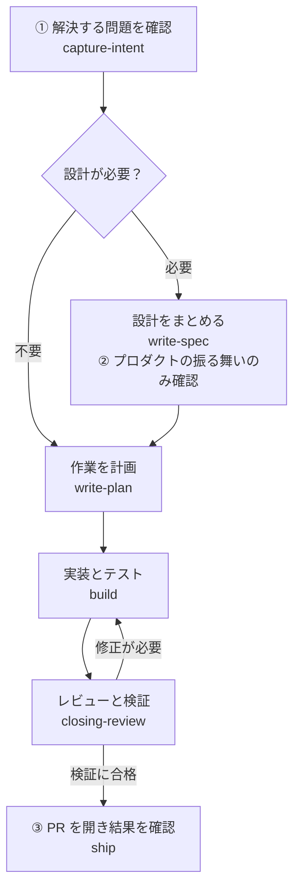

# loom-code

[Loom](https://github.com/kouko/loom-plugins/blob/main/README.md)

skill の詳細は、同じ言語の翻訳がある場合はその版、それ以外は英語版にリンクします。

> **5 つのステーションが一つの変更を確認済みの intent からマージ待ちの
> pull request まで運び、何かがマシンの外に出る前に決定的な checker が
> 証拠を再計算します。** loom-code が前提にするのは基本的なソフトウェア工学の
> 知識であって、この plugin の知識ではありません。1 変更につき質問は最大 3 つ、
> 残りは理由を記録した上で自分で決めます。品質の出どころは機械が機械を
> 検査することです — 書く agent がレビューする agent になることは決して
> ありません。

**バージョン**: 3.87.2 · **Skills**: 5 ステーション + 1 ルーター + 1 外部レビュー用 skill + 1 研究用 skill · [CHANGELOG.md](CHANGELOG.md)
**言語**: [English](README.md) | [日本語](README.ja.md) | [繁體中文](README.zh-TW.md)
**リポジトリ**: [kouko/loom-plugins](https://github.com/kouko/loom-plugins)

---

## 変更の流れ



図の skill は `loom-code` が提供し、`capture-intent` と `write-spec` は
`loom-design` が提供します。`loom-design` がなければ、`write-plan` が intent の
確認と必要な最小 spec を担当します。マージと保守はこの変更の主フローから分け、
下で説明します。

- **Intent** — `loom-design` を入れている場合は `capture-intent` が intent を
  確認し（①）、入れていない場合は `write-plan` が変更を言い直して ① を自分で
  訊きます。
- **仕様** — ② を訊くのは product の変更だけで、訊くのは spec を書いた側です：
  `loom-design:write-spec`、または code のみのインストールでは `write-plan` の
  最小 spec。
- **ビルドとレビュー** — `build` は全タスクに implementer を割り当て、テストから
  書き、最後に独立した adversary の敵対プログラムと package テスト一式を
  走らせます。これらが通るまで引き渡しません。`closing-review` はその確認済みの
  内容にクロージングレビューを 1 回行います。`NEEDS_REVISION` は
  指摘を `build` に戻し、合格した証拠は、レビューされた機能内容に結び付く
  attestation として生成されます。
- **Ship** — ブランチを push し、PR を開き、必須チェックを確認します（③）。
  Ship はマージしません。マージは、あなた自身の明示的な許可が要る別の手順です。
- **Maintain** — 進行中の未マージ変更の外で起き、ユーザーからのバグ修正依頼
  ではないアラート・CI やリグレッションの失敗・障害を、一致する open な
  intent に結び付けるか新しい intent を作り、`write-plan` に渡します。
  ユーザーがバグ修正を依頼したときは入口のステーションから始めます。

## Skills

| Skill | 役割 |
|---|---|
| [`write-plan`](skills/write-plan/README.md) | 確認済みの intent を `docs/loom/<change-id>/plan.md` に変える：ファイル、担当する Acceptance 行、テストケース、リスクを持つ wave 分けされたタスク。`loom-design` がなければ ① を自分で行う。 |
| [`build`](skills/build/README.md) | タスクごとに implementer を 1 つ割り当て、テストファーストで plan を実装し、最後に adversary と package テスト一式を走らせる。これらが通るまで引き渡さない。 |
| [`closing-review`](skills/closing-review/README.md) | Build の確認を通った内容にクロージングレビュー（レビュアー、必要に応じて acceptance testing）を行い、`docs/loom/<change-id>/attestation.json` を生成する。 |
| [`ship`](skills/ship/README.md) | attestation を検証し、push し、PR を開き、必須チェックを確認する（決定点 ③）。マージはしない。 |
| [`maintain`](skills/maintain/README.md) | 進行中の未マージ変更の外で起きた障害を再現し、一致する open な intent に結び付けるか新しく作り、`write-plan` に渡す。 |
| [`using-loom-code`](skills/using-loom-code/README.md) | 一般的な Loom の依頼に合うステーションを選ぶ任意のルーター。各ステーションは引き続き直接呼び出せる。 |
| [`external-review`](skills/external-review/README.md) | 同意を得た外部レビューを明示的なモデルと effort で実行する。呼び出し元の review skill が基準と verdict の検証を保つ。 |
| [`engineering-research`](skills/engineering-research/README.md) | Loom の作業や単独の技術議論で判断を左右する根拠を調べ、問いごとの研究記録を残す。マージ後の Vault 保存は、その都度、保存先と範囲の承認を得る**スキルがその承認を求める**。 |

## Agents

ステーションが次の agent を派遣します。自分の成果物をレビューする agent は
いません。

| Agent | 派遣元 | 役割 |
|---|---|---|
| [`implementer`](agents/implementer.md) | `build` | 1 タスク：失敗するテストを先に書き、1 コミット、状態レポート — verdict は出さない。 |
| [`reviewer`](agents/reviewer.md) | `closing-review` | fresh-context の verdict（`PASS` / `PASS_WITH_NOTES` / `NEEDS_REVISION`）と位置付きの指摘。レビュー対象は編集しない。 |
| [`acceptance-tester`](agents/acceptance-tester.md) | `closing-review` | クリーンな環境で変更を動かして全 Acceptance 行を確かめ、`docs/loom/<change-id>/acceptance-test-report.md` を書く。 |
| [`adversary`](agents/adversary.md) | `build` | 変更を壊しにいく — mutation や fuzz ツール、または実行可能な悪用・境界ケース — そしてすべての試行を probe として記録する。 |

レビュアーの人数は agent が選ぶのではありません。`loom_checker.py
reviewer-count` がブランチ全体の差分から計算します — 狭く低リスクな変更なら
1 人、それ以外や判定できないときは 2 人です。**closing-review はこの検証済みの
reviewer-count 結果を使用します**。acceptance testing が行われるのは、Acceptance
行を機械的に判定できないときだけです。

## 訊かれる 3 つの質問

これ以外はすべて理由を記録した上で自動的に決まります。

1. **これがやりたいことですか？** — コードが存在する前に、意図を平易な
   言葉で言い直したもの。
2. **X と打つと Y が見える。合っていますか？** — 目に見える振る舞い。
   product の変更でのみ訊かれ、engineering では訊かれません。
3. **できましたか？** — 結果を受け入れます。acceptance test report が必要だった場合は、
   その変更に一切触れていない agent が書いたレポートを読みます。

後から戻しにくい選択（データの削除、公開インターフェース、片道のマイグレーション）は、
engineering の変更なら ①、product の変更なら ②（spec を書かないなら ①）で重大な影響を伝えます。
そこで質問するのは、ユーザーが望む結果を既存の決定から判断できない場合、または明示的な許可が欠けている場合だけです。
既存データの変更や送信には引き続き明示的な同意が必要です。余分な停止点は増やしません。

## contract package

`contract/manifest.yaml` がステーション、ツール、アクション、そしてすべての
artifact — intent・spec・plan・attestation・acceptance test report・`KICKOFF-DEFAULTS.md` —
の charter とフィールド、さらに standing document を宣言します。空のひな型は
`contract/templates/` にあります。書き込むのは loom-code のみ。`loom-design` は
自分が埋めるひな型をバイト単位で同一のコピーとして持ち（リポジトリのテストが
一致を保ちます）、`requires-contract` を宣言します。どちらの sibling も実行時に
このパッケージを読みません。

## checker

`plan <path> --json` と `intake <station> <change-id> --json` は、準備検査の
バージョン 1 の結果を stdout に出力します。**--json は出力形式を変更しつつ、
チェックと終了コードは保持します**。成功、ルールによる拒否、使用／内部
エラーを区別し、診断と通知の順序を保持しますが、ワークフロー全体の完了は
意味しません。**各コマンドの `--help` には、起動時の標準出力やプロセス
失敗の制限についての記述があります**。各コマンドの `--help` を参照すれば
フィールドの一覧がわかります。（help には `suggested_next` も含まれます）。

五つの checker コマンドが JSON をサポートします：`plan`、`intake`、`contract`、
`reviewer-count`、`delivery`。最初の四つは末尾の `--json` のみで JSON を選び、
重複セレクタは使用エラー。コマンドの正確な `--help`/`-h` は引き続きテキスト出力です。
二つの読み取り専用モードで help と最終 JSON が混在するのは使用エラー；plan/intake は
混在形式を通常の入力として検証します。delivery は独自の
`{state, reason, next, evidence, complete}` フィールドを保ち、
`suggested_next` を `next` と等しく追加します；共通エンベロープやスキーマバージョンは
追加しません。通常のテキスト出力は state/next 行を保ち、同じアドバイスを stderr に
追加します。delivery は Help/error stderr を保持する場合があり、**結果生成前に失敗した場合
（無効な `--goal` などの引数エラーを含む）は JSON を出力せず、stderr にテキスト診断のみで
exit 2 となる**ことがあります。準備モードの空 stderr 契約は適用されません。

二つの読み取り専用モードは、完了した観測時に準備エンベロープへ `data` を追加します：

| コマンド | 完了観測時の型付きデータ |
|---|---|
| `contract --require <major.minor> --json` | `contract_version` と `required_version` 文字列、`compatible` 真偽値；最後の `--require` が優先。指定された要求文字列は保持され、manifest バージョンは周囲の空白を除去して `data.contract_version` として返されます。 |
| `reviewer-count <change-id> --json` | 不変の `change_id` 文字列（**少なくとも 1 文字の非空白文字を含む**）と整数 `reviewer_floor`（現在は 1 または 2）；クリーンなリポジトリと非空白の単一 change ID が必要です。 |

それぞれは標準出力に正確に 1 個の JSON オブジェクトと改行を出力し、checker stderr は空です：
`schema_version: 1`、`command`、`status`、順序付き `diagnostics` オブジェクト
（`rule_id`、`message`）、順序付き文字列 `notices`、`error`、`data`。
四つのバージョン 1 モードはすべて助言的 `suggested_next` を出します：ブロック/エラー時は
**少なくとも 1 文字の非空白文字を含む英語の文字列**、通過時は null。テキスト拒否/エラーは `Suggested next step:` を
stderr に追加し、元の診断と Help ヒントを保持します。通過は exit 0、空 diagnostics、null error；
ブロックは exit 1、ルール diagnostics、null error；エラーは exit 2、空 diagnostics、
`error: {kind: usage|internal, message}`。すべての error data 値は null です。
reviewer-count にブロッカー結果はなく、欠落/ダーティリポジトリは使用エラー。
空配列は `[]` のままです。キー順や人間向けメッセージではなく、フィールドと型を使ってください。

計画とクロージングレビューは、成功プローズを解析したりバリデータを重複させたりせず、
共有の checked consumer を使います。`<loom-code>` をインストール済みプラグイン
ディレクトリに置き換え、機能作業を commit した後の選択されたクリーンリポジトリで
reviewer 呼び出しを実行します。

```sh
"<loom-code>/scripts/loom-python" --repair --script checked_readonly.py contract --require 2.1
"<loom-code>/scripts/loom-python" --ready --script checked_readonly.py reviewer-count <change-id>
"<loom-code>/scripts/loom-python" --ready --script checked_readonly.py --help
```

この consumer は `--json` を追加し、バージョン/コマンド、必須型、不変のリクエスト
アイデンティティと exit/status 合意を検証し、互換性のある追加フィールドを保持します。
**共通するフィールド**：`schema_version`、`command`、`status`、`diagnostics`（順序付き）、
`notices`、`error`、`suggested_next`。
**read-only コマンド専用のフィールド**：`data` は `plan` と `intake` では含まれず、
`contract` と `reviewer-count` に含まれます。詳しくは各コマンドの `--help` を参照してください。
**この helper が結果を受理するまで、計画は継続せず、reviewer も派遣されません**。
受理された passed かつ true compatibility のみが計画継続を許可し、受理された passed かつ
正の整数 `data.reviewer_floor` のみが reviewer 派遣を決めます。互換性のない `2.99` はブロック観測；不正な `bad` は有効な
使用エラーです。無効な出力は空標準出力、`checked-readonly:` 診断、exit 2。エラーも
無効結果も継続や reviewer デフォルト、テキストフォールバック、自動リトライを許しません。
コア観測を受理した後、適用可能な `suggested_next` を**非空白文字列**の時だけ助言として
提示し、それ以外（欠落、null、空白のみ、別の型）は元の診断を保持します。受理された生 JSON に使えないアドバイスが
含まれる可能性があります：コア検証は任意のアドバイスを信頼可能や実行可能にしません。
アドバイスは認可を与えず、自動実行をトリガーしません。contract 拒否の場合は診断の
示すプラグインに従います；loom-code か消費側プラグインのいずれかが古い可能性があります。
consumer の故障は、元の診断と exit 区別を保ったまま、ローカルで生成されたアドバイスを
stderr に追加します。

このヘルパーは、設定された 30 秒のサブプロセス timeout と起動 exit 86 の保持で
checker を 1 回実行します。artifact を書いたり、runtime をインストールしたり、
ポリシー・権限・ホスト信頼を変更したりはしません；外側の launcher の `--repair` が
キャッシュを準備し、`--ready` がそれを再利用します。構造的検査は計算の真実や
ワークフロー全体の完了を証明しません。既存の結果分類、必須フィールド、リモート操作の
調停はそのままです。全 16 checker コマンドが助言的振る舞いを定義し、5 つの直接 JSON
モードと 2 つの checked station consumer があります。通常のテキストは stderr で
`Suggested next step:` を使い、GitHub rules の通常レポートは標準出力を保持します。
アドバイスのみの OSError/UnicodeError は結果を変更せず、アクションを繰り返しません。
未知や未同期の exit-zero 結果はそのまま未知・未同期のままです；成功した検査に
フィラーは不要です。hook ペイロード/ネイティブ hook バイト、セットアップ、CI アノテーション、
進捗、必須クリーンアップ cwd 引き渡しはそれぞれのプロトコルを保ちます。
[CLI 結果ガイド](references/cli-results.md) は各コマンド/モードを実行可能な検査に
マッピングし、例外を説明します。追加の JSON モード、checked consumer、自動アクションは
導入しません。解決率、時間、トークン、コストの向上は測定されていません。

`scripts/loom_checker.py` が決定的な層です。どのルールも宣言を信じずに
リポジトリから再計算し、ルール一覧は `--list-rules` が正です。終了コードは
合格で 0、ルールによるブロックで 1、使い方や内部のエラーで 2 — 判定できない
checker が「問題なし」と言うことはありません。ステーションは intake、
`reviewer-count`、`finalize-review` でこれを呼びます。`finalize-review` は
コミット済みの内容で package テストと敵対プログラムを再度走らせ、内容に結び付く attestation を
生成します。インストール済みの `PreToolUse` hook は `git push` と
`gh pr create` の前にもう一度走り、内容の digest を再計算して、テストや probe を
再実行せずにその証拠を検証します。
同じ hook は、シェル入力が `git merge`、`git commit`、`git push` で始まる場合、
`main` または `master` で止めます。後ろに `&&` や `;` が続いても対象です。
機能ブランチでの作業は続行できます。`cd ... && git push` のように前に別の
コマンドがある場合、ラッパー、スクリプトは対象外です。リポジトリ固有の
`loom.protectMain=false` 設定で保護を無効にできます。

ステーションは `scripts/loom-python --repair` で checker 専用の Python と依存
パッケージをユーザーキャッシュに用意し、元のチェックを再実行します。プロジェクトの
テスト環境は変更しません。標準ライブラリだけを使う簡単な hook は、動作する
システムの Python を使い、使えなければ準備済みのキャッシュ環境を使います。
checker を使う push hook は `--ready` で**インストール済みの hook が既存の checker runtime を再利用し**、実行時に何もインストールしません。環境が使えない場合は修復方法を知らせます。

## loom-design・loom-workflow との組み合わせ

3 つの plugin は独立してインストール可能です。loom-code は `loom-design` も
`loom-workflow` も必要とせず、任意の受け渡し先が不在のときは、その受け渡しを
理由付きで N/A と報告し、自分の契約が許す範囲で続行します。

- **loom-design** は `write-plan` の上流に `capture-intent` と `write-spec` を
  足します。入れていない場合は `write-plan` が intent の確認と最小 spec の
  作成を自分で行います。
- **loom-workflow** はステーションの周りにツールを足します。たとえば
  `loom-workflow:git-memory` は、`ship` が PR 本文の memory を分類するのに
  使います。

接続点は `loom-design:write-spec` のような plugin 名付き skill 名と、
プロジェクト自身の `docs/loom/` 成果物だけで、他 plugin の
`hooks/`・`skills/`・`scripts/` を直接読むことはありません。

## インストール

このリポジトリは `loom` という名前の plugin marketplace です。

### Claude Code

```bash
claude plugin marketplace add https://github.com/kouko/loom-plugins.git
claude plugin install loom-code@loom
```

`loom-design` と `loom-workflow` も同じ手順で入ります。

### Codex

```bash
codex plugin marketplace add https://github.com/kouko/loom-plugins.git
codex plugin add loom-code@loom
codex plugin list
```

インストール済みの `PreToolUse` hook がpush 操作の割り込みを担います。導入先の
repo に checker のコピー、複製した contract、trust ledger は要りません。

安全に更新するには、次の順序で実行します。

```bash
codex plugin marketplace upgrade loom
codex plugin add loom-code@loom
codex plugin list
```

`plugin add` はインストール済み version の cache を置き換えるため、動作中の
task が保持している version 付き hook path を削除する場合があります。成功後は、
別の tool や command を実行する前に Codex を直ちに再起動してください。先に
plugin を削除しても、同じ path 不在期間が早く始まるだけなので行いません。

### Antigravity CLI

Antigravity CLI（`agy`）はローカルのディレクトリから plugin をインストール
します。repo を clone し、`loom-code` を兄弟 plugin より先に入れます。
インストール前に `agy plugin list` で Claude Code から取り込まれた同名の plugin が
ないか確認してください。install はその取り込み済みのコピーを置き換え、後の
`agy plugin uninstall` はそれを削除します。

```bash
git clone https://github.com/kouko/loom-plugins.git
cd loom-plugins
agy plugin validate ./loom-code
agy plugin install ./loom-code
agy plugin list
```

使うときは、プロジェクトのディレクトリでプロジェクトを絶対パスで workspace に追加して
`agy` を起動します：`agy --add-dir "$PWD"`（対話）または
`agy --add-dir "$PWD" -p "..."`（print モード）。agy 1.2.2 は `.` のような相対パスを
受け付けません。`--add-dir` がないと print モード（`agy -p`）では agy は workspace を
持たないため、loom の kickoff defaults が読み込まれず、agent がプロジェクトの外で
作業することがあります。対話モードでも指定してください。

更新は clone で `git pull` してから install を再実行します（install は
インストール済みのコピーを置き換えます）。削除は `agy plugin uninstall loom-code`
です。hook（push リマインダー・session context・言語リマインダー）が走るのは `agy` CLI だけで、
Antigravity のデスクトップアプリや IDE では走りません。`agy` 上では loom の役割
（implementer・reviewer・adversary・acceptance-tester）は、loom の agent 契約に従う
agy の `self` subagent として Gemini モデルで動きます。review station は
どの host でも `closing-review` で、旧名 `review` は別名なしで削除されました。

### OpenCode

OpenCode v2（2.0.18 で確認。CLI でインストールした plugin は TUI でも読み込まれる）は GitHub から plugin をインストールします。

```sh
opencode plugin add 'github:kouko/loom-plugins#main::path:loom-code'
opencode plugin list
```

その後 OpenCode を再起動します（`opencode service restart`）。再起動するまで、`opencode plugin list` には一部の plugin しか出ないことがあります。

OpenCode の TUI（2.0.18–2.0.20）には plugin をインストールする項目がありません。`plugin add` の代わりに、同じ spec を `opencode.json`（`plugin add` が OpenCode の設定フォルダ `~/.config/opencode/` に書き込むファイル）の `plugins` リストに追加することもできます。更新するには、`plugin add` や `plugin update` を再実行しても何も起きません（OpenCode 2.0.18 は `already configured` / `No plugin updates available` と答え、branch 指定はキャッシュ済みのコピーを再利用します）。plugin を削除し、commit に固定して追加し直し、OpenCode を再起動してください：`opencode plugin remove 'github:kouko/loom-plugins#main::path:<plugin>'`（追加したときの spec そのままです。plugin 名だけでは `not configured` と返ります）、続けて `opencode plugin add 'github:kouko/loom-plugins#<commit>::path:<plugin>'`。

skill は `loom-code:<skill>` として提供されます。loom の役割は OpenCode の subagent `loom-code:<role>` として `subagent` ツール経由でセッションのモデルで動きます。loom はコマンド `/loom-code:using-loom-code` で始めます（skill としても引き続き提供されます）。

OpenCode では、セッションコンテキスト、push リマインダー、言語リマインダーが plugin の v2 hook で動きます。

OpenCode での制限は次のとおりです。

- バックグラウンドサービスの起動直後は、plugin が `opencode plugin list` に現れるまで最大 40 秒ほどかかることがあります。
- loom-code の subagent は、plugin キャッシュにある loom のファイルを読むときに `external_directory` の許可プロンプトで止まることがあります。`opencode run --auto` も subagent のセッションには効きません。loom の plugin ディレクトリの読み取りを許可してください。
- `--auto` なしの `opencode run` は最初の許可プロンプトかモデルからの質問で止まるため、長い loom の実行は TUI から行ってください。
- OpenCode はプロジェクト外のシェルコマンドの前に確認しないため、モデルがマシンを変更することがあります（観測例：システム全体への `pip install --break-system-packages`）。コマンドを確認するか、OpenCode の許可設定を厳しくしてください。
- OpenCode のデスクトップアプリと IDE 連携は対象外です。
- plugin を使うのに Node は不要です。

## ライセンス

MIT。loom-code は `monkey-skills` で開発され、現在は
[kouko/loom-plugins](https://github.com/kouko/loom-plugins) にあります。
