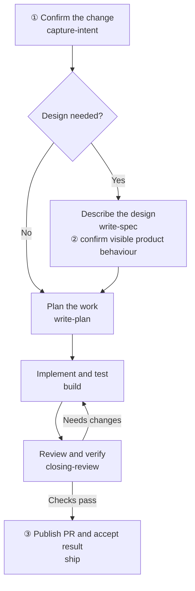

# loom-code

[Loom](https://github.com/kouko/loom-plugins/blob/main/README.md)

Skill guides open in English unless a matching translation is available.

> **Five stations carry one change from a confirmed intent to a published
> pull request, and a deterministic checker recomputes the evidence before
> anything leaves the machine.** loom-code assumes you know basic software
> engineering, not this plugin: it asks you at most three questions per
> change and decides the rest itself, with the reason recorded. Quality comes
> from machines checking machines — the agent that writes is never the agent
> that reviews.

**Version**: 3.76.0 · **Skills**: 5 stations + 1 router + 1 external review skill + 1 research skill · [CHANGELOG.md](CHANGELOG.md)
**Languages**: [English](README.md) | [日本語](README.ja.md) | [繁體中文](README.zh-TW.md)
**Repository**: [kouko/loom-plugins](https://github.com/kouko/loom-plugins)

---

## How a change flows



Skill names in this diagram use `loom-code`, except `capture-intent` and `write-spec`,
which use `loom-design`. Without `loom-design`, `write-plan` handles intent
confirmation and any needed minimal spec. Merging and maintenance are separate
from this change flow; see their descriptions below.

- **Intent** — with `loom-design` installed, `capture-intent` confirms the
  intent (①); without it, `write-plan` restates the change and asks ① itself.
- **Specification** — only a product change asks ②, at whoever writes the
  spec: `loom-design:write-spec`, or `write-plan`'s minimal spec on a
  code-only install.
- **Build and review** — `build` dispatches an implementer for every task,
  test first, and ends with an independent adversary's adversarial programs
  and the complete package suite, which must pass before hand-off.
  `closing-review` runs one closing review of that checked content; `NEEDS_REVISION` returns the
  findings to `build`, and passing evidence becomes a generated attestation
  bound to the reviewed functional content.
- **Ship** — pushes the branch, opens the PR and verifies required checks
  (③). Ship never merges: merging is a separate step that needs your own
  explicit authorization.
- **Maintain** — outside an active unmerged change, an alert, CI or regression
  failure, or incident that arrives without a user's request to fix a bug is
  attached to a matching open intent, or a new one is created, and handed to
  `write-plan`. A user asking for a bug fix starts at the entry station.

## Skills

| Skill | Role |
|---|---|
| [`write-plan`](skills/write-plan/README.md) | Turn a confirmed intent into `docs/loom/<change-id>/plan.md`: waved tasks with files, owned Acceptance lines, test cases and risk. Runs ① itself when `loom-design` is absent. |
| [`build`](skills/build/README.md) | Implement the plan test-first, dispatching one implementer per task, then run the adversary and the complete package suite, which must pass before hand-off. |
| [`closing-review`](skills/closing-review/README.md) | Run the closing review — reviewers and acceptance testing as needed — on content that passed Build's checks, and generate `docs/loom/<change-id>/attestation.json`. |
| [`ship`](skills/ship/README.md) | Validate the attestation, push, open the PR and verify required checks (decision point ③). Never merges. |
| [`maintain`](skills/maintain/README.md) | Reproduce an incident outside an active unmerged change, attach it to a matching open intent or create one, and hand it to `write-plan`. |
| [`using-loom-code`](skills/using-loom-code/README.md) | Optional router that picks the station for a general Loom request; every station stays directly callable. |
| [`external-review`](skills/external-review/README.md) | Run a consented outside review with an explicit model and effort; the calling review skill keeps its criteria and verdict checks. |
| [`engineering-research`](skills/engineering-research/README.md) | Resolve consequential evidence gaps during Loom tasks or standalone engineering discussions, retain question-scoped research records, and offer post-merge preservation with per-instance Vault authorization. |

## Agents

The stations dispatch these agents; none reviews its own work.

| Agent | Dispatched by | Role |
|---|---|---|
| [`implementer`](agents/implementer.md) | `build` | One task: failing test first, one commit, a status report — never a verdict. |
| [`reviewer`](agents/reviewer.md) | `closing-review` | Fresh-context verdict (`PASS` / `PASS_WITH_NOTES` / `NEEDS_REVISION`) with anchored findings; never edits what it reviews. |
| [`acceptance-tester`](agents/acceptance-tester.md) | `closing-review` | Runs the change in a clean environment against every Acceptance line and writes `docs/loom/<change-id>/acceptance-test-report.md`. |
| [`adversary`](agents/adversary.md) | `build` | Tries to make the change fail — mutation or fuzz tooling, or executable abuse and boundary cases — and records every attempt as a probe. |

The checker computes the reviewer count from the whole branch delta; closing
review uses its checked `reviewer-count` observation — one for a narrow,
low-risk change, two otherwise or when it cannot tell. Acceptance testing happens
only when an Acceptance line cannot be settled mechanically.

## The three questions you are asked

Everything else is decided for you, with the reason recorded.

1. **Is this what you want?** — your intent, restated in plain words before
   any code exists.
2. **You type X and you see Y — right?** — the visible behaviour, asked only
   for a product change, never for an engineering one.
3. **Did it do it?** — you accept the result, reading the acceptance test report
   written by an agent that never touched the change when one was required.

For a hard-to-reverse choice (deleting data, a public interface, a one-way
migration), disclose its material consequences at ① for an engineering change
or ② for a product change (① when no spec is written). Ask a question there
only when the user's outcome preference remains unresolved or explicit
authorization is missing. Changing or sending existing data still requires
explicit consent; no extra stop is added.

## The contract package

`contract/manifest.yaml` declares the stations, tools, actions and the
charter and fields of every artifact — intent, spec, plan, attestation,
acceptance test report and `KICKOFF-DEFAULTS.md` — plus the standing documents.
`contract/templates/` holds the blank of each. Only loom-code writes it.
`loom-design` keeps byte-identical copies of the templates it fills (a
repository test keeps them equal) and declares `requires-contract`; neither
sibling reads this package at runtime.

## The checker

`plan <path> --json` and `intake <station> <change-id> --json` opt into a
version-1 preparation result on stdout. The final selector preserves default
text behavior and exit codes. Results distinguish passed checks, blockers and
usage/internal errors, retain ordered diagnostics and notices, and do not
claim whole-workflow completion. Use either command's exact `--help` for the
six-field contract and startup/process limitations.

Five checker commands support JSON: `plan`, `intake`, `contract`,
`reviewer-count`, and `delivery`. The first four select JSON only with a final
`--json`; duplicate selectors are usage errors. Exact command `--help`/`-h`
remains text; mixed help and final JSON is a usage error. Delivery retains its
distinct `{state, reason, next, evidence, complete}` object.

The two read-only modes add `data` to the preparation envelope:

| Command | Typed data on a completed observation |
|---|---|
| `contract --require <major.minor> --json` | `contract_version` and `required_version` strings, `compatible` boolean; last `--require` wins. The supplied requirement string is preserved, and the manifest version is stripped. |
| `reviewer-count <change-id> --json` | Unchanged `change_id` string and integer `reviewer_floor` (currently 1 or 2); requires a clean repository and one nonblank operand. |

Each emits exactly one stdout object plus newline and empty checker stderr:
`schema_version: 1`, `command`, `status`, ordered `diagnostics` objects
(`rule_id`, `message`), ordered string `notices`, `error`, and `data`.
Passed means exit 0, empty diagnostics and null error; blocked means exit 1,
rule diagnostics and null error; error means exit 2, empty diagnostics and
`error: {kind: usage|internal, message}`. Every error data value is null.
Reviewer-count has no blocker result; missing/dirty repositories are usage
errors. Empty arrays remain `[]`. Use fields and types rather than key order
or human message prose.

Planning and closing review use a shared checked consumer rather than parsing
success prose or duplicating validators. Replace `<loom-code>` with the
installed plugin directory; run the reviewer call inside the selected clean
repository after committing functional work.

```sh
"<loom-code>/scripts/loom-python" --repair --script checked_readonly.py contract --require 2.1
"<loom-code>/scripts/loom-python" --ready --script checked_readonly.py reviewer-count <change-id>
"<loom-code>/scripts/loom-python" --ready --script checked_readonly.py --help
```

The consumer adds `--json`, validates version/command, required types, unchanged
request identity and exit/status agreement, and preserves compatible extra
fields. Only accepted passed/true compatibility permits planning to continue;
only an accepted passed positive integer `data.reviewer_floor` determines
reviewer dispatch. An incompatible `2.99` is a blocked observation; malformed
`bad` is a valid usage error. Invalid output has empty stdout, a
`checked-readonly:` diagnostic and exit 2. Neither errors nor invalid results
permit continuation, reviewer defaults, text fallback or automatic retries.

This helper executes the checker once with a configured 30-second subprocess
timeout and preserves startup exit 86. It neither writes artifacts, installs
runtime nor changes policy, authority or host trust; the outer launcher's
`--repair` can prepare caches, while `--ready` reuses them. Structural checking
does not prove computational truth or whole-workflow completion. Existing
text, preparation/delivery JSON and remote-operation reconciliation remain.
The [CLI result guide](references/cli-results.md) inventories all sixteen
commands, their special modes and remaining migration work: five direct JSON
commands, two checked station consumers, no claim of full migration.

`scripts/loom_checker.py` is the deterministic layer: every rule recomputes
from the repository instead of trusting a claim, and `--list-rules` is the
source of truth for the rule list. It exits 0 on pass, 1 on a blocked rule
and 2 on a usage or internal error, so a checker that cannot decide never
says "fine". Stations call it at intake, for `reviewer-count` and for
`finalize-review`, which runs the package tests and adversarial programs again
on committed content and generates the content-bound attestation. The installed `PreToolUse` hook
runs it again before `git push` and `gh pr create`: it recomputes the content
digest and validates that evidence without replaying tests or probes.
The same hook blocks `git merge`, `git commit`, and `git push` when the Git
command starts the shell input on `main` or `master`, even if `&&` or `;`
follows it. Feature-branch work continues. A prefixed command such as
`cd ... && git push`, a wrapper, or a script is outside this guard; the
repo-local `loom.protectMain=false` setting opts out a specific repository.

Stations use `scripts/loom-python --repair` to prepare their own checker Python
and dependencies in a user cache, then rerun the original check. This does not
change the project's test environment. Simple standard-library hooks use a
viable host Python, falling back to a ready cached runtime if one is unavailable.
Checker-backed publication hooks use `--ready`: they reuse an existing runtime
without installing anything and report how to repair it when the runtime is
unavailable.

## Composing with loom-design and loom-workflow

The three plugins are independently installable: loom-code needs neither
`loom-design` nor `loom-workflow`, and when a station reaches an optional
handoff whose sibling is absent it reports that handoff as N/A with the reason
and continues where its own contract allows.

- **loom-design** adds `capture-intent` and `write-spec` upstream of
  `write-plan`; without it, `write-plan` confirms the intent and writes a
  minimal spec itself.
- **loom-workflow** adds tools around the stations, such as
  `loom-workflow:git-memory`, which `ship` uses to classify memory for the PR
  body.

They compose only through plugin-qualified skill names such as
`loom-design:write-spec` and the project's own
`docs/loom/` artifacts — never through another plugin's private `hooks/`,
`skills/` or `scripts/` paths.

## Install

This repository is a plugin marketplace named `loom`.

### Claude Code

```bash
claude plugin marketplace add https://github.com/kouko/loom-plugins.git
claude plugin install loom-code@loom
```

`loom-design` and `loom-workflow` install the same way.

### Codex

```bash
codex plugin marketplace add https://github.com/kouko/loom-plugins.git
codex plugin add loom-code@loom
codex plugin list
```

The installed `PreToolUse` hook owns publication interception; adopting
repositories carry no checker copy, copied contract, or trust ledger.

To update safely:

```bash
codex plugin marketplace upgrade loom
codex plugin add loom-code@loom
codex plugin list
```

`plugin add` replaces the installed version cache and can remove the versioned
hook path held by an active task. After it succeeds, restart Codex immediately
before running another tool or command. Do not remove the plugin first; that
only creates the same broken-path window earlier.

### Antigravity CLI

Antigravity CLI (`agy`) installs a plugin from a local directory. Clone the
repository and install `loom-code` before its siblings. Before installing, check
`agy plugin list` for a `loom-code` imported from Claude Code: installing
replaces that imported copy, and a later `agy plugin uninstall` removes it.

```bash
git clone https://github.com/kouko/loom-plugins.git
cd loom-plugins
agy plugin validate ./loom-code
agy plugin install ./loom-code
agy plugin list
```

To use loom, start `agy` from your project with the project added as a
workspace by absolute path: `agy --add-dir "$PWD"` (interactive) or
`agy --add-dir "$PWD" -p "..."` (print mode); agy 1.2.2 does not honour a
relative path such as `.`. Without `--add-dir`, print mode (`agy -p`)
attaches no workspace, so loom's kickoff defaults are not loaded and the
agent may act outside the project; pass it in interactive mode too.

To update, run `git pull` in the clone and install again; the install replaces
the installed copy. `agy plugin uninstall loom-code` removes it. The hooks (the
publication reminder, the session context and the language reminder) run only in
the `agy` CLI, not in the Antigravity desktop app or IDE. On `agy` the loom roles (implementer,
reviewer, adversary, acceptance-tester) run as agy `self` subagents that follow
loom's agent contracts, on Gemini models. The review station is
`closing-review` on every host; the old `review` name was removed and has no
alias.

### OpenCode

OpenCode v2 (verified on 2.0.18; plugins installed from the CLI also load in the TUI) installs plugins from GitHub.

```sh
opencode plugin add 'github:kouko/loom-plugins#main::path:loom-code'
opencode plugin list
```

Then restart OpenCode (`opencode service restart`): until it restarts, `opencode plugin list` may show only some of the plugins.

The OpenCode TUI (2.0.18–2.0.20) has no plugin-install option; instead of `plugin add` you can add the same spec to the `plugins` list in `opencode.json`, the file `plugin add` writes in OpenCode's config folder `~/.config/opencode/`. To update, re-running `plugin add` or `plugin update` does nothing (OpenCode 2.0.18 answers `already configured` / `No plugin updates available`, and a branch spec reuses its cached copy). Remove the plugin, then add it again pinned to a commit, and restart OpenCode: `opencode plugin remove 'github:kouko/loom-plugins#main::path:<plugin>'` (the exact spec you added; the bare name answers `not configured`), then `opencode plugin add 'github:kouko/loom-plugins#<commit>::path:<plugin>'`.

Skills are offered as `loom-code:<skill>`. loom's roles run as OpenCode subagents `loom-code:<role>` through the `subagent` tool, on the session's model. Start loom with the command `/loom-code:using-loom-code`, which stays a skill too.

On OpenCode, the session context, the publication reminder and the language reminder run through the plugin's v2 hooks.

Limits on OpenCode:

- A plugin can take up to about 40 seconds to appear in `opencode plugin list` right after the background service starts.
- loom-code's subagents can stop on an `external_directory` permission prompt when they read loom's installed files from the plugin cache, even under `opencode run --auto`, which does not cover subagent sessions. Approve reads of the loom plugin directory.
- `opencode run` without `--auto` stops at the first permission prompt or model question, so drive long loom runs from the TUI.
- OpenCode does not ask before shell commands outside the project, so a model can change the machine (observed: a system-wide `pip install --break-system-packages`); review its commands or tighten OpenCode's permission settings.
- The OpenCode desktop app and IDE integrations are not covered.
- Node is not needed to use the plugins.

## Licence

MIT. loom-code was developed in `monkey-skills` and now lives in
[kouko/loom-plugins](https://github.com/kouko/loom-plugins).
