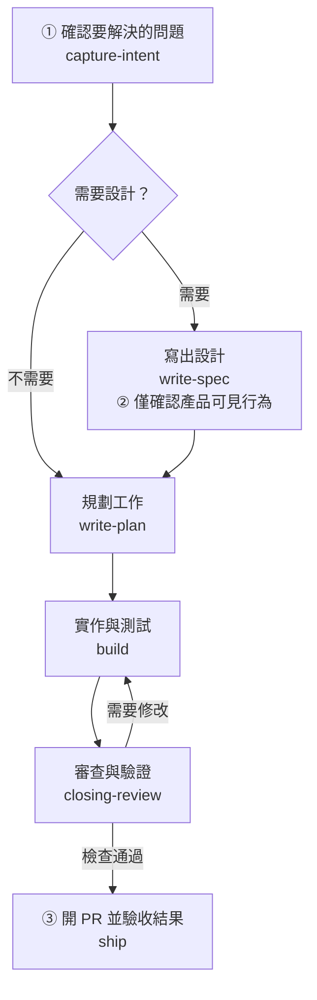

# loom-code

[Loom](https://github.com/kouko/loom-plugins/blob/main/README.md)

技能詳細頁有同語言翻譯時連至該版本，其餘連至英文版。

> **五個站把一次變更從確認過的 intent 送到等待合併的 pull request；任何東西
> 離開本機之前，決定性的 checker 會重算一次證據。** loom-code 假設你具備
> 基本軟體工程知識，而不是熟悉這個 plugin：每次變更最多問你三個問題，其餘
> 自己決定並記下理由。品質的來源是機器檢查機器 —— 寫的 agent 永遠不會是
> 審的 agent。

**版本**：3.87.2 · **Skills**：5 個站 + 1 個入口路由 + 1 個外部審查 skill + 1 個研究 skill · [CHANGELOG.md](CHANGELOG.md)
**語言**：[English](README.md) | [日本語](README.ja.md) | [繁體中文](README.zh-TW.md)
**儲存庫**：[kouko/loom-plugins](https://github.com/kouko/loom-plugins)

---

## 一次變更怎麼走



圖中的技能由 `loom-code` 提供；`capture-intent` 與 `write-spec` 則由
`loom-design` 提供。沒裝 `loom-design` 時，由 `write-plan` 確認需求並在需要時
寫出最小規格。合併與維護不放進這次變更的主流程，詳見下方說明。

- **Intent** —— 裝了 `loom-design` 時由 `capture-intent` 確認 intent（①）；
  沒裝時，`write-plan` 自己覆述這次變更並問 ①。
- **規格** —— 只有 product 變更會問 ②，由寫 spec 的那一方問：
  `loom-design:write-spec`，或只裝 code 時 `write-plan` 寫的最小 spec。
- **建置與審查** —— `build` 為每個任務派一個 implementer，測試先行，最後由獨立的
  adversary 寫出對抗程式並跑完整 package 測試，全數通過才交出。`closing-review`
  對這份已檢查的內容跑一次收尾審查；`NEEDS_REVISION` 把發現退回 `build`，通過的證據會產生為一份
  綁定受審功能內容的 attestation。
- **Ship** —— push 分支、開 PR、確認必要的 checks（③）。Ship 從不合併：合併是
  另一步，需要你另外明確授權。
- **Maintain** —— 在進行中未合併變更之外發生、且不是使用者要求修 bug 的告警、
  CI 或回歸失敗、事故，會掛到相符的 open intent 上，沒有就新建一份，再交給
  `write-plan`。使用者要求修 bug 時從入口站開始。

## Skills

| Skill | 角色 |
|---|---|
| [`write-plan`](skills/write-plan/README.md) | 把確認過的 intent 變成 `docs/loom/<change-id>/plan.md`：分 wave 的任務，各帶檔案、負責的 Acceptance 行、測試案例與風險。沒裝 `loom-design` 時自己跑 ①。 |
| [`build`](skills/build/README.md) | 每個任務派一個 implementer，以測試先行實作 plan，最後跑 adversary 與完整 package 測試，全數通過才交出。 |
| [`closing-review`](skills/closing-review/README.md) | 對通過 Build 檢查的內容跑收尾審查——審查者，視需要加 acceptance testing——並產生 `docs/loom/<change-id>/attestation.json`。 |
| [`ship`](skills/ship/README.md) | 驗證 attestation、push、開 PR、確認必要的 checks（決策點 ③）。從不合併。 |
| [`maintain`](skills/maintain/README.md) | 重現發生在進行中未合併變更之外的事故，掛到相符的 open intent 或新建一份，再交給 `write-plan`。 |
| [`using-loom-code`](skills/using-loom-code/README.md) | 選配的入口路由，替一般 Loom 請求挑站；每個站仍可直接呼叫。 |
| [`external-review`](skills/external-review/README.md) | 經同意後，以明確的模型與 effort 執行外部審查；呼叫它的審查 skill 保留自己的標準與 verdict 檢查。 |
| [`engineering-research`](skills/engineering-research/README.md) | 查證 Loom 任務或獨立工程討論中會影響決策的證據缺口，按問題保存研究紀錄；合併後的 Vault 保存逐次確認目的地與範圍。 |

## Agents

各站派出下列 agent；沒有任何 agent 審自己的產出。

| Agent | 派出者 | 角色 |
|---|---|---|
| [`implementer`](agents/implementer.md) | `build` | 一個任務：先寫會失敗的測試、一個 commit、一份狀態回報 —— 不下 verdict。 |
| [`reviewer`](agents/reviewer.md) | `closing-review` | fresh-context 的 verdict（`PASS` / `PASS_WITH_NOTES` / `NEEDS_REVISION`）與帶位置的發現；從不修改受審對象。 |
| [`acceptance-tester`](agents/acceptance-tester.md) | `closing-review` | 在乾淨環境跑這次變更、逐條走過每一行 Acceptance，寫出 `docs/loom/<change-id>/acceptance-test-report.md`。 |
| [`adversary`](agents/adversary.md) | `build` | 設法讓變更失敗 —— mutation 或 fuzz 工具，或可執行的濫用與邊界案例 —— 並把每次嘗試記成 probe。 |

審查者人數不是 agent 自己選的：`loom_checker.py reviewer-count` 依整條分支的
差異計算 —— 範圍窄且低風險的變更一位，其他情況或無法判斷時兩位。只有當某行
Acceptance 無法機械判定時才會做 acceptance testing。

## 會問你的三個問題

其餘全部代你決定，並記下理由。

1. **這是你要的嗎？** —— 在任何程式碼存在之前，用白話覆述你的意圖。
2. **你打 X，會看到 Y，對嗎？** —— 可見的行為。只有 product 變更會問，
   engineering 不問。
3. **做到了嗎？** —— 你驗收結果；需要 acceptance test report 時，讀的是從未碰過這次變更的
   agent 寫的那份報告。

難以回頭的選擇（刪資料、公開介面、單向遷移），在 engineering 變更時於 ①、
product 變更時於 ②（不寫 spec 時於 ①）說明重大後果。只有使用者想要的結果仍無法從既有決定判斷，
或缺少明確授權時，才在該決策點提問。變更或傳送既有資料仍需明確同意；不另開停頓點。

## contract package

`contract/manifest.yaml` 宣告站、工具、action，以及每一種 artifact ——
intent、spec、plan、attestation、acceptance test report、`KICKOFF-DEFAULTS.md` —— 的
charter 與欄位，還有 standing document。空白範本在 `contract/templates/`。
只有 loom-code 寫它。`loom-design` 保留它要填的範本的逐位元組相同副本（由
repo 測試保持一致）並宣告 `requires-contract`；兩個 sibling 執行時都不讀這個
package。

## checker

`plan <path> --json` 與 `intake <station> <change-id> --json` 可選擇輸出
版本 1 的準備檢查結果。`--json` 必須放最後；預設文字與退出碼保持不變。
結果區分通過、規則阻擋與使用／內部錯誤，保留診斷及提示的順序，並不代表
整體工作完成。六個欄位與啟動／程序失敗限制可由各命令的精確 `--help` 查閱。

五個 checker 指令支援 JSON：`plan`、`intake`、`contract`、
`reviewer-count`、`delivery`。前四者僅透過尾部 `--json` 選取 JSON；
重複 selector 為用法錯誤。指令的精確 `--help`/`-h` 仍為文字輸出。兩個
read-only 模式混用 help 與最終 JSON 為用法錯誤；plan/intake 視混合形式為
一般輸入驗證。delivery 保留其獨特的 `{state, reason, next, evidence, complete}`
欄位並增設 `suggested_next` 等於 `next`；無共用 envelope 或 schema version。
一般文字保留 state/next 行並在 stderr 加上相同建議。delivery 可能保留
Help/error stderr，含 `--json` 的前置結果失敗；準備模式的空 stderr 契約不適用。

兩個 read-only 模式在完成觀測時向準備 envelope 增加 `data`：

| 指令 | 完成觀測的型別資料 |
|---|---|
| `contract --require <major.minor> --json` | `contract_version`、`required_version` 字串、`compatible` 布林值；最後的 `--require` 為準。提供的要求字串保留，manifest 版本去除前後空白並作為 `data.contract_version` 返回。 |
| `reviewer-count <change-id> --json` | 不變的 `change_id` 字串與整數 `reviewer_floor`（目前 1 或 2）；需乾淨 repo 與非空單一 operand。 |

各模式輸出恰一個標準輸出 JSON 物件加換行，checker stderr 為空：
`schema_version: 1`、`command`、`status`、有序 `diagnostics` 物件
（`rule_id`、`message`）、有序字串 `notices`、`error`、`data`。
四個 v1 模式亦輸出建議性 `suggested_next`：阻擋/錯誤為**非空白**英文字串，
通過為 null。文字拒絕/錯誤在 stderr 附加 `Suggested next step:`；原始
diagnostics 與 Help 提示保留。通過即 exit 0、空 diagnostics、null error；
阻擋即 exit 1、rule diagnostics、null error；錯誤即 exit 2、空 diagnostics、
`error: {kind: usage|internal, message}`。所有 error data 值為 null。
reviewer-count 無 blocker 結果；缺失/髒 repo 為用法錯誤。空陣列仍為 `[]`。
請用欄位與型別而非鍵順或人言判斷。

規劃與 closing-review 使用共享 checked consumer，而非解析成功文案
或重複 validator。將 `<loom-code>` 替換為已安裝 plugin 目錄；在 commit
功能工作後的選定乾淨 repo 執行 reviewer 呼叫。

```sh
"<loom-code>/scripts/loom-python" --repair --script checked_readonly.py contract --require 2.1
"<loom-code>/scripts/loom-python" --ready --script checked_readonly.py reviewer-count <change-id>
"<loom-code>/scripts/loom-python" --ready --script checked_readonly.py --help
```

此 consumer 加入 `--json`，驗證 version/command、必要型別、不變的請求
identity 與 exit/status 一致，保留相容的額外欄位。僅 accepted passed 且
true compatibility 允許規劃繼續；僅 accepted passed 正整數 `data.reviewer_floor`
決定 reviewer 派遣。不相容 `2.99` 為 blocked 觀測；malformed `bad` 為有效
用法錯誤。無效輸出為空 stdout、`checked-readonly:` 診斷、exit 2。錯誤與
無效結果皆不允許續行、reviewer 預設、文字 fallback、自動重試。接受核心
觀測後，僅在**非空白字串**時呈現適用的 `suggested_next` 作為建議；否則（缺失、null、空白、別型別）保留原始
診斷。接受的原始 JSON 可能含無用建議：核心驗證不使任意建議可信或可執行。
建議不授權、不觸發自動動作。contract 拒絕時依診斷指示的 plugin；loom-code
或消費端 plugin 可能較舊。consumer 故障保留原診斷與 exit 區別，在 stderr
加上本地產生的建議。

此 helper 以配置的 30 秒 subprocess timeout 與保留啟動 exit 86 執行
checker 一次。不寫 artifact、不裝 runtime、不改 policy/authority/host trust；
外層 launcher `--repair` 準備 cache，`--ready` 重用之。結構檢查不證明計算
真理或整體工作完成。既有結果分類、必要欄位、remote-operation 協調保留。
全部 16 checker 指令定義建議行為，含 5 直接 JSON 模式與 2 checked station
consumer。一般文字 stderr 用 `Suggested next step:`；GitHub rules 正常報告
保留 stdout。建議類 OSError/UnicodeError 不改結果、不重複動作。未知或
未同步 exit-zero 結果維持未知/未同步；成功檢查無需填充。hook payloads/
native-hook bytes、setup、CI annotations、progress、強制 cleanup cwd handoff
各保留其協定。[CLI 結果指南](references/cli-results.md) 將各指令/模式對應
可執行檢查並解釋例外。不新增 JSON 模式、checked consumer、自動動作。解決率、
時間、token、成本無測得提升。

`scripts/loom_checker.py` 是決定性層：每條規則都從 repo 重算，不採信宣稱，
規則清單以 `--list-rules` 為準。通過時退出碼 0，規則擋下時 1，用法或內部
錯誤時 2 —— 無法判斷的 checker 永遠不會說「沒問題」。各站在 intake、
`reviewer-count` 與 `finalize-review` 時呼叫它；`finalize-review` 在已 commit 的
內容上再跑一次 package 測試與對抗程式，並產生綁定內容的 attestation。已安裝的 `PreToolUse`
hook 在 `git push` 與 `gh pr create` 之前再跑一次：重算內容 digest，並在不重跑
測試或 probe 的情況下驗證那份證據。
同一個 hook 也會在 Git 專案的 `main` 或 `master` 分支阻止以
`git merge`、`git commit` 或 `git push` 開頭的 shell 輸入；即使後面接著
`&&` 或 `;` 也會阻止。功能分支可照常工作。`cd ... && git push` 這類
前面有其他指令的輸入、包裝命令與腳本不在保護範圍內；特定儲存庫可透過
`loom.protectMain=false` 本機設定停用保護。

各站透過 `scripts/loom-python --repair` 在使用者快取中備妥 checker 專用的
Python 與套件，接著重跑原本的檢查；使用者專案的測試環境不受影響。只用標準函式庫
的簡單 hook 會使用可運作的系統 Python；若無法使用，則改用已備妥的快取環境。
需要 checker 的 push hook 以 `--ready` 沿用已備妥的環境，不自行安裝；環境不可用時
會顯示修復方式。

## 與 loom-design、loom-workflow 組合

三個 plugin 可獨立安裝：loom-code 不需要 `loom-design`，也不需要
`loom-workflow`；某一站走到選配的交接而該 plugin 不在時，該交接以 N/A 加理由
回報，並在自身契約允許的範圍內繼續。

- **loom-design** 在 `write-plan` 上游加上 `capture-intent` 與 `write-spec`；
  沒裝時，`write-plan` 自己確認 intent 並寫最小 spec。
- **loom-workflow** 在各站周圍加上工具，例如 `ship` 用
  `loom-workflow:git-memory` 為 PR 內文分類 memory。

相接處只有帶 plugin 名的 skill 名（例如 `loom-design:write-spec`）
以及專案自己的 `docs/loom/` 產物 —— 不會去讀別的 plugin 的
`hooks/`、`skills/`、`scripts/`。

## 安裝

這個儲存庫是一個名為 `loom` 的 plugin marketplace。

### Claude Code

```bash
claude plugin marketplace add https://github.com/kouko/loom-plugins.git
claude plugin install loom-code@loom
```

`loom-design` 與 `loom-workflow` 安裝方式相同。

### Codex

```bash
codex plugin marketplace add https://github.com/kouko/loom-plugins.git
codex plugin add loom-code@loom
codex plugin list
```

已安裝的 `PreToolUse` hook 負責攔截 push 操作；採用的 repo 不需要保存 checker
副本、複製的 contract 或 trust ledger。

若要安全更新，請依序執行：

```bash
codex plugin marketplace upgrade loom
codex plugin add loom-code@loom
codex plugin list
```

`plugin add` 會替換已安裝版本的快取，因此可能刪除執行中 task 仍持有的版本化
hook 路徑。安裝成功後，請立刻重新啟動 Codex，再執行任何其他工具或命令。不要
先移除 plugin；那只會讓同一段路徑失效期間更早開始。

### Antigravity CLI

Antigravity CLI（`agy`）從本機目錄安裝 plugin。先 clone repo，並在另外兩個
plugin 之前安裝 `loom-code`。安裝前先用 `agy plugin list` 確認有沒有從 Claude Code
匯入的同名 plugin：install 會取代那份匯入的副本，之後的 `agy plugin uninstall`
也會把它刪掉。

```bash
git clone https://github.com/kouko/loom-plugins.git
cd loom-plugins
agy plugin validate ./loom-code
agy plugin install ./loom-code
agy plugin list
```

使用時，在專案目錄啟動 `agy` 並以絕對路徑把專案加為 workspace：
`agy --add-dir "$PWD"`（互動）或 `agy --add-dir "$PWD" -p "..."`（print 模式）；
agy 1.2.2 不接受 `.` 這類相對路徑。沒有 `--add-dir` 時，print 模式（`agy -p`）
不會掛上 workspace，loom 的 kickoff defaults 不會載入，agent 也可能在專案外動作；
互動模式也請一併指定。

更新時在 clone 裡執行 `git pull`，再重跑 install（install 會取代已安裝的副本）；
移除用 `agy plugin uninstall loom-code`。hook（push 提醒、session
context 與語言提醒）只在 `agy` CLI 執行，Antigravity 桌面 app 與 IDE 裡不會執行。在 `agy`
上，loom 的角色（implementer、reviewer、adversary、acceptance-tester）以 agy 的
`self` subagent 執行，遵循 loom 的 agent 契約，使用 Gemini 模型。審查站在所有
host 上都叫 `closing-review`，舊名 `review` 已移除，沒有別名。

### OpenCode

OpenCode v2（已在 2.0.18 驗證；從 CLI 安裝的 plugin 在 TUI 裡也會載入）從 GitHub 安裝 plugin。

```sh
opencode plugin add 'github:kouko/loom-plugins#main::path:loom-code'
opencode plugin list
```

接著重啟 OpenCode（`opencode service restart`）；重啟之前，`opencode plugin list` 可能只列出部分 plugin。

OpenCode 的 TUI（2.0.18–2.0.20）沒有安裝 plugin 的選項；除了 `plugin add`，也可以把同一個 spec 加進 `opencode.json`（`plugin add` 寫入 OpenCode 設定資料夾 `~/.config/opencode/` 的那個檔案）的 `plugins` 清單。更新時，重跑 `plugin add` 或 `plugin update` 都不會有作用（OpenCode 2.0.18 回應 `already configured` / `No plugin updates available`，且 branch 指定會沿用快取副本）。請先移除 plugin，再固定到某個 commit 重新加入，並重啟 OpenCode：`opencode plugin remove 'github:kouko/loom-plugins#main::path:<plugin>'`（要用加入時的完整 spec；只寫 plugin 名稱會回應 `not configured`），接著 `opencode plugin add 'github:kouko/loom-plugins#<commit>::path:<plugin>'`。

skill 以 `loom-code:<skill>` 提供。loom 的角色以 OpenCode subagent `loom-code:<role>` 透過 `subagent` 工具執行，使用 session 的模型。以指令 `/loom-code:using-loom-code` 開始使用 loom（它同時仍是 skill）。

在 OpenCode 上，session context、push 提醒與語言提醒透過 plugin 的 v2 hook 執行。

OpenCode 的限制：

- 背景服務剛啟動時，plugin 最多約 40 秒才會出現在 `opencode plugin list`。
- loom-code 的 subagent 從 plugin 快取讀取 loom 自己的檔案時，可能停在 `external_directory` 權限提示；`opencode run --auto` 也不涵蓋 subagent 的 session。請允許讀取 loom 的 plugin 目錄。
- 不加 `--auto` 的 `opencode run` 會停在第一個權限提示或模型提問，長時間的 loom 執行請從 TUI 進行。
- OpenCode 在專案以外執行 shell 指令前不會詢問，模型可能改動整台機器（實測：系統層級的 `pip install --break-system-packages`）；請檢查它的指令，或收緊 OpenCode 的權限設定。
- OpenCode 桌面 app 與 IDE 整合不在涵蓋範圍。
- 使用這些 plugin 不需要 Node。

## 授權

MIT。loom-code 原本在 `monkey-skills` 開發，現在位於
[kouko/loom-plugins](https://github.com/kouko/loom-plugins)。
