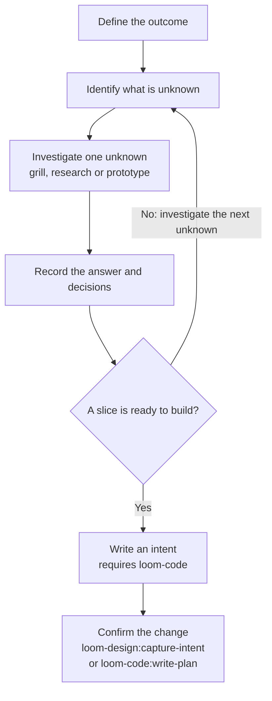

# loom-workflow

[Loom](../README.md)

Skill guides open in English unless a matching translation is available.

Read this in: **English** | [日本語](README.ja.md) | [繁體中文](README.zh-TW.md)

> Workflow tools around the Loom stations for Claude Code and Codex: persistent Outcome Maps, git memory, repository memory, critique, recap, handoff, single-session retro, recurring skill retrospective, chat visualizations and reasoning pages, and second opinions.

**Version**: 5.19.1 · **Repository**: [kouko/loom-plugins](https://github.com/kouko/loom-plugins) · **License**: MIT

## Name migration

| Before 5.9.0 | From 5.9.0 | Use for |
|---|---|---|
| `retro` | `project-retro` | One project development session. |
| `distill-sessions` | `skill-retro` | Recurring behavior of a readable target skill across selected past or current sessions. |

The old names are no longer callable. Update the installed plugin to 5.9.0 to use the new names. Both skills return proposals for a separate implementation workflow; neither applies changes.

## What it is

Loom carries one change through its stations: `loom-design` captures the
intent and spec, and `loom-code` plans, builds, reviews and ships it.
`loom-workflow` holds the tools around those stations. They are not stations
themselves: each one attaches at a specific moment or runs on demand, and every
tool can be invoked directly by name.

Most tools work with `loom-workflow` installed alone. `decision-map`'s delivery
step needs `loom-code` to write an intent from its contract template; charting
a map and working its tickets do not. An explicitly requested outside code,
plan or decision review also needs `loom-code:external-review` for execution.

## Admission rule

A skill belongs here when it coordinates work across stations or carries state
across sessions, not merely because several plugins use it. `decision-map` is
the rule's first instance. The rule gates new admissions only; the utility
skills already in the plugin stay.

`project-retro` is an explicit, user-approved exception: an on-demand, read-only review
of one coding session for project development improvements. It does not become
a Loom station or quality gate.

## When you reach for which tool

These tools are selected by need; the rows are not steps to execute in order.

| When you need help | Tool | What it does |
|---|---|---|
| The route to the outcome is still unclear | `decision-map` | Investigate unknowns and deliver a ready slice as an intent. |
| A proposal needs a critical check | `critique` | Judge whether the proposed work is necessary or can be simpler. |
| You lose track during a session | `recap-state` | Explain the current position and wait for your confirmation. |
| A prior lesson matters, or a new one should be kept | `loom-memory` | Recall on demand; record durable lessons before the branch closes, on request or by agent judgment. No station calls it. |
| You write, edit or review a dbt model | `dbt-model-style` | Apply model style and structure; calculation logic stays out of scope. |
| You commit, create a PR or merge | `git-memory` | Classify memory before every commit at any station, at PR creation and before merge. |
| You end a session or resume in another | `handoff` | Save state to a file or verify it before resuming. |
| You want to learn from sessions | `project-retro`, `skill-retro` | Review one session for project improvements, or selected snapshots for recurring skill issues. Propose changes without applying them. |
| You want another executor's review | `independent-advisor` | Get a second opinion with authorization for cost and material sent off the machine. |
| A relationship needs a visual explanation | `loom-visualization`, `loom-interactive-diagram` | Show a chat table or diagram, or create an editable diagram. |
| You explicitly ask for a goal | `goal-create` | Draft a session goal or repository purpose; runs only when named. |
| You are unsure which tool to use | `using-loom-workflow` | Route your request; each tool can also be invoked directly. |

### Decision-map loop

Only `decision-map` has the exploration loop below. The map lives at
`docs/loom/maps/<map-id>/` and persists across sessions. Charting and working
its tickets do not require `loom-code`; delivering an intent does.



A grilling ticket hands its discussion to `loom-design:capture-intent` when
available. Delivery writes an intent carrying `map:`; the entry station then
owns that change and the map only reads its status. This loop is not the
completion condition for the whole map: completion requires all Destination
acceptance criteria met, fog empty, and every ticket closed or withdrawn.

## Skills

Fourteen skills: thirteen tools and one optional router.

| Skill | Role |
|---|---|
| [`using-loom-workflow`](skills/using-loom-workflow/README.md) | Optional router: picks the matching tool for a broad or unclear request and loads its instructions. Every tool stays directly invocable. |
| [`decision-map`](skills/decision-map/README.md) | Chart or advance a persistent Outcome Map at `docs/loom/maps/<map-id>/`: a Destination, fog, typed tickets and a Decisions-so-far log; its delivery step writes an intent. |
| [`critique`](skills/critique/README.md) | Judge a proposal before it is built: `mode: proposal` sorts a list or plan into KEEP / DEFER / DROP; `mode: complexity` weighs one specific change deletion-first. |
| [`recap-state`](skills/recap-state/README.md) | In-session recap of where the work stands, then a pause for confirmation. Not the built-in `/recap` away-summary. |
| [`loom-memory`](skills/loom-memory/README.md) | Recall, record, reconcile or retire durable repository lessons in the committed memory store. |
| [`dbt-model-style`](skills/dbt-model-style/README.md) | Apply dbt + Redshift model style and structure (CTE roles, a zero-logic final CTE, naming, comments) when writing, editing or reviewing a model; calculation logic is out of scope. |
| [`git-memory`](skills/git-memory/README.md) | Classify Decision, Learning and Gotcha memory before every `git commit`, `gh pr create` and `gh pr merge`; recall why a past Git decision was made. |
| [`handoff`](skills/handoff/README.md) | Save session state to a HANDOFF file under `.claude/handoffs/`, or resume from one in a new session. |
| [`skill-retro`](skills/skill-retro/README.md) | Review selected past or current Claude Code and Codex session snapshots against readable target skill sources or related plugin integration; return source-linked proposals without applying changes. Current snapshots exclude events after capture; source paths need no local installation. Two distinct sessions promote a proposal; one remains pending. |
| [`project-retro`](skills/project-retro/README.md) | On request, review the current or one specified coding session for source-backed project development improvements. Report possible skill issues separately as candidates; do not edit files. |
| [`independent-advisor`](skills/independent-advisor/README.md) | Route an explicitly requested outside code, plan or decision review through `loom-code:external-review`, preserving the owning review's criteria; also get an open-ended second opinion from another model tier, effort or vendor. Spending money or sending material off the machine needs approval. |
| [`loom-visualization`](skills/loom-visualization/README.md) | Show comparisons, flows, decisions, states, or reasoning chains in coding-harness chat as a table, ASCII diagram, or Mermaid block that actually displays in the reader's client; a reasoning page mode renders documented reasoning as a standalone page. Its plain-language reference holds a writing guide, a decision-option rule, eight conversation-situation tables and table rules; three table collections cover software, design and business. Not for Obsidian notes. |
| [`loom-interactive-diagram`](skills/loom-interactive-diagram/README.md) | Create and validate editable draw.io diagrams during Loom changes or standalone discussions. Ask before editing an existing external diagram whether to copy it into the project; report the selected file path. |
| [`goal-create`](skills/goal-create/README.md) | Invoked by name only. SESSION drafts a four-field goal prompt from conversation evidence or confirmed intent/spec and activates it when accepted by the host, with an honest recovery action otherwise. It does not operate the Loom workflow. ARC drafts the repository purpose (`Why` / `Done when`). |

Loom's contract counts eight of these tools. `goal-create` and
`dbt-model-style` and `project-retro` are standalone skills outside the Loom flow, and
`loom-memory` and the router stay outside the contract.

## Repository structure

```
loom-workflow/
├── .claude-plugin/
│   └── plugin.json
├── .codex-plugin/
│   └── plugin.json
├── docs/                  governance, audit, telemetry and design notes
├── hooks/
│   ├── hooks.json         UserPromptSubmit card, skill folder structure check after Write/Edit and host memory reminder
│   ├── memory-mirror-reminder PostToolUse reminder to classify host memory notes via loom-memory
│   └── visualization-card UserPromptSubmit visualization card for loom-visualization
├── scripts/               plugin-level tests and the structure check
├── skills/
│   ├── critique/
│   ├── dbt-model-style/
│   ├── decision-map/
│   ├── git-memory/
│   ├── goal-create/
│   ├── handoff/
│   ├── independent-advisor/
│   ├── loom-memory/
│   ├── loom-visualization/
│   ├── project-retro/
│   ├── recap-state/
│   ├── skill-retro/
│   └── using-loom-workflow/
├── tests/                 git-memory, loom-memory, loom-visualization and retro tests
├── CHANGELOG.md
├── README.md              (this file)
├── README.ja.md
└── README.zh-TW.md
```

## Install

This repository is a plugin marketplace named `loom`. `loom-workflow` installs
on its own; add `loom-code` for `decision-map`'s delivery step or an explicitly
requested outside code, plan or decision review.

### Claude Code

```sh
claude plugin marketplace add https://github.com/kouko/loom-plugins.git
claude plugin install loom-workflow@loom
```

### Codex

```sh
codex plugin marketplace add https://github.com/kouko/loom-plugins.git
codex plugin add loom-workflow@loom
```

On Codex, the visualization card for loom-visualization arrives on every message you send
through a plugin UserPromptSubmit hook, which Codex runs only after you review
and trust the plugin's hooks. If you trusted the hook in an earlier version,
review and trust it again: its event changed.

### Antigravity CLI

Install from a clone of the repository. Install `loom-code` first. `critique`,
`decision-map` and `skill-retro` refer to it. Before installing, check
`agy plugin list` for a plugin of the same name imported from Claude Code:
installing replaces that imported copy, and a later `agy plugin uninstall`
removes it.

```bash
git clone https://github.com/kouko/loom-plugins.git
cd loom-plugins
agy plugin install ./loom-code
agy plugin install ./loom-workflow
```

To use loom, start `agy` from your project with the project added as a
workspace by absolute path: `agy --add-dir "$PWD"` (interactive) or
`agy --add-dir "$PWD" -p "..."` (print mode); agy 1.2.2 does not honour a
relative path such as `.`. Without `--add-dir`, print mode (`agy -p`)
attaches no workspace, so loom's kickoff defaults are not loaded and the
agent may act outside the project; pass it in interactive mode too.

Its hooks run only in the `agy` CLI, not in the Antigravity desktop app or IDE.
On agy, the visualization card for loom-visualization is delivered as a plugin rule, so it
is always on.

### OpenCode

OpenCode v2 (verified on 2.0.18; plugins installed from the CLI also load in the TUI) installs plugins from GitHub. Install `loom-code` first: `opencode plugin add 'github:kouko/loom-plugins#main::path:loom-code'`.

```sh
opencode plugin add 'github:kouko/loom-plugins#main::path:loom-workflow'
opencode plugin list
```

Then restart OpenCode (`opencode service restart`): until it restarts, `opencode plugin list` may show only some of the plugins.

The OpenCode TUI (2.0.18–2.0.20) has no plugin-install option; instead of `plugin add` you can add the same spec to the `plugins` list in `opencode.json`, the file `plugin add` writes in OpenCode's config folder `~/.config/opencode/`. To update, re-running `plugin add` or `plugin update` does nothing (OpenCode 2.0.18 answers `already configured` / `No plugin updates available`, and a branch spec reuses its cached copy). Remove the plugin, then add it again pinned to a commit, and restart OpenCode: `opencode plugin remove 'github:kouko/loom-plugins#main::path:<plugin>'` (the exact spec you added; the bare name answers `not configured`), then `opencode plugin add 'github:kouko/loom-plugins#<commit>::path:<plugin>'`.

Skills are offered as `loom-workflow:<skill>`. Start loom with the command `/loom-workflow:using-loom-workflow`; `/loom-workflow:handoff`, `/loom-workflow:recap-state`, `/loom-workflow:goal-create` and `/loom-workflow:project-retro` are also commands, and each of these stays a skill too.

On OpenCode, the visualization card and the skill-folder rule run through the plugin's v2 hooks.

Limits on OpenCode:

- A plugin can take up to about 40 seconds to appear in `opencode plugin list` right after the background service starts.
- loom-code's subagents can stop on an `external_directory` permission prompt when they read loom's installed files from the plugin cache, even under `opencode run --auto`, which does not cover subagent sessions. Approve reads of the loom plugin directory.
- `opencode run` without `--auto` stops at the first permission prompt or model question, so drive long loom runs from the TUI.
- OpenCode does not ask before shell commands outside the project, so a model can change the machine (observed: a system-wide `pip install --break-system-packages`); review its commands or tighten OpenCode's permission settings.
- The OpenCode desktop app and IDE integrations are not covered.
- Node is not needed to use the plugins.

### Where the per-turn reminder does not arrive

On Claude Code, Codex and OpenCode, `loom-workflow` sends the visualization card for
loom-visualization (reply in the user's language, conclusion first, plain words,
literal wording, tables and diagrams) to the agent on every message you send,
through a UserPromptSubmit hook; it adds up to 181 words per turn. It does not
reach:

- the Codex IDE extension or the Codex app;
- the Antigravity desktop app or IDE (plugin hooks and rules run only in the `agy` CLI);
- an install of `loom-code` without `loom-workflow`: the card ships only in `loom-workflow`.

## Usage

`loom-workflow` ships no slash commands. Ask in natural language, or name a
skill; `goal-create` runs only when named. For example:

```
"Critique this 12-item plan"                  → critique (proposal)
"Should we build this?" / "over-engineered?"  → critique (complexity)
"I'm about to commit"                         → git-memory
"開地圖" / "chart a decision map"             → decision-map
"wrap up" / "save state"                      → handoff
"where were we" / "我跟丟了"                  → recap-state
"second opinion" / "ask another model"        → independent-advisor
```

## Development

From the repository root, the full package suite runs in an isolated
environment:

```sh
uv run --isolated --with-requirements requirements-package-tests.lock python scripts/run_package_tests.py --loom-family -q
```

## Provenance

- `loom-workflow` was developed in `monkey-skills` and extracted into this
  repository; the homepage and repository URLs inside its manifest still point
  to that origin. It replaced `dev-workflow` in a hard-cut rename, so custom
  references use `loom-workflow:<skill>`.
- `loom-memory` joined this plugin when its independent plugin retired.
- `skill-creator-advance`, `skill-refactor`, `skill-tuning` and `skill-judge`
  moved to `skill-dev-toolkit`; the original design rationale is archived in
  [`docs/skill-evolution-architecture.md`](docs/skill-evolution-architecture.md).

## License

MIT. See [LICENSE](https://github.com/kouko/loom-plugins/blob/main/LICENSE). `critique`'s `mode: complexity` derives from
joshuadavidthomas's MIT-licensed
[`reducing-entropy`](https://github.com/joshuadavidthomas/agent-skills/tree/main/skills/reducing-entropy);
its `LICENSE` and `NOTICE` files keep the copyright chain.
