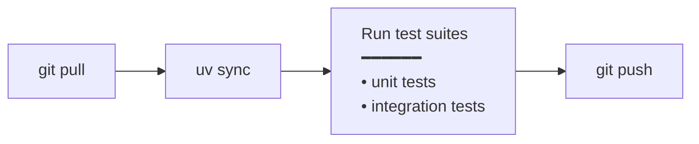

target: coding-harness

# Linear steps

## When to use

Three or more steps that always run in the same order with no branch: a
release procedure, a build pipeline, a setup sequence. If any step can go two
ways, use the branching decision template instead.

## Table

| # | Step | Command | Done when |
|---|---|---|---|
| 1 | Update | `git pull` | branch is current |
| 2 | Install | `uv sync` | lockfile resolved |
| 3 | Test | `pytest` | all tests pass |
| 4 | Publish | `git push` | remote has the commit |

## ASCII

A reply defaults to the table above; draw this when the shape itself is the
information, or when the destination does not render markdown.

Run `python3 <skill-dir>/scripts/generate.py flow` (`<skill-dir>` is defined
in `SKILL.md`) with this input on stdin:

```json
{"steps": ["git pull", "uv sync", {"title": "Run test suites", "body": ["* unit tests", "* integration tests"]}, "git push"]}
```

Output:

```
┌─────────────────────┐
│      git pull       │
└─────────────────────┘
           │
           ▼
┌─────────────────────┐
│       uv sync       │
└─────────────────────┘
           │
           ▼
┌─────────────────────┐
│ Run test suites     │
├─────────────────────┤
│ * unit tests        │
│ * integration tests │
└─────────────────────┘
           │
           ▼
┌─────────────────────┐
│      git push       │
└─────────────────────┘
```

### Before/after flows in titled panels

Use this layout when the change is a difference between two processes, rather
than a comparison of options. Put a localized title **inside each outer frame**
so the diagram remains understandable when copied without its surrounding text.
Align corresponding steps when they actually correspond; do not invent steps,
remove branches or force equal topology to make the columns match. For branching
processes, use the branching template for the inner diagrams.

Use “Before” / “After” only when the evidence supports those states. Label a
proposal “Expected after” (`預期修改後`), and distinguish a user's report from
observed behavior. This example illustrates a reported invoice-export bug and
its requested correction, not an implemented or verified result:

```
┌────────────────────────────┐  ┌────────────────────────────┐
│    修改前（使用者回報）    │  │         預期修改後         │
├────────────────────────────┤  ├────────────────────────────┤
│  ┌──────────────────────┐  │  │  ┌──────────────────────┐  │
│  │   匯出某客戶的發票   │  │  │  │   匯出某客戶的發票   │  │
│  └──────────────────────┘  │  │  └──────────────────────┘  │
│              │             │  │              │             │
│              ▼             │  │              ▼             │
│  ┌──────────────────────┐  │  │  ┌──────────────────────┐  │
│  │ 偶爾用到前一位的幣別 │  │  │  │ 使用該客戶自己的幣別 │  │
│  └──────────────────────┘  │  │  └──────────────────────┘  │
│              │             │  │              │             │
│              ▼             │  │              ▼             │
│  ┌──────────────────────┐  │  │  ┌──────────────────────┐  │
│  │   發票顯示錯誤幣別   │  │  │  │ 發票顯示該客戶的幣別 │  │
│  └──────────────────────┘  │  │  └──────────────────────┘  │
└────────────────────────────┘  └────────────────────────────┘
```

Keep side-by-side diagrams within the available display width (about 72 cells
by default). Otherwise stack the complete panels vertically, retaining both
in-frame titles. If even one panel is too wide, shorten or wrap its labels
without changing their meaning. Do not replace option-comparison tables with
these panels, or add a process diagram to a simple wording correction.

## Reproduce the titled comparison

Run the following from a shell, replacing `<skill-dir>` with the skill's path.
It uses the existing flow renderer and display-width helper, with no new
generator or dependency. Set `72` to the available width; `40` demonstrates
the stacked layout. Replace the case facts and titles for the actual request.

```sh
python3 - <skill-dir> 72 > /tmp/flow-comparison.txt <<'PY'
from itertools import zip_longest
from pathlib import Path
import sys

sys.path.insert(0, str(Path(sys.argv[1]) / "scripts"))
from generate import render
from width import display_width

cases = [
    ("修改前（使用者回報）", ["匯出某客戶的發票", "偶爾用到前一位的幣別", "發票顯示錯誤幣別"]),
    ("預期修改後", ["匯出某客戶的發票", "使用該客戶自己的幣別", "發票顯示該客戶的幣別"]),
]
flows = [render("flow", {"steps": steps}).splitlines() for _, steps in cases]
width = max(display_width(s) for s in [*(t for t, _ in cases),
            *(line for flow in flows for line in flow)]) + 4
panels = []
for (title, _), flow in zip(cases, flows):
    gap = width - display_width(title)
    panel = ["┌" + "─" * width + "┐",
             "│" + " " * (gap // 2) + title + " " * (gap - gap // 2) + "│",
             "├" + "─" * width + "┤"]
    panel += ["│  " + s + " " * (width - 2 - display_width(s)) + "│" for s in flow]
    panels.append(panel + ["└" + "─" * width + "┘"])
if 2 * (width + 2) + 2 <= int(sys.argv[2]):
    blank = " " * (width + 2)
    print("\n".join(a + "  " + b for a, b in zip_longest(*panels, fillvalue=blank)))
else:
    print("\n\n".join("\n".join(panel) for panel in panels))
PY
python3 <skill-dir>/scripts/align.py /tmp/flow-comparison.txt
```

Always verify the final composition, including both outer frames; checking only
the generated inner flows does not verify their placement inside the panels.

## Mermaid



## Common mistakes

- Drawing a flow for two steps; a sentence is clearer.
- Hiding a condition inside a step label ("test, and if it fails, fix").
- Writing `->` instead of `-->` in Mermaid; it does not parse.
- Hand-padding the ASCII boxes instead of using the generator.
