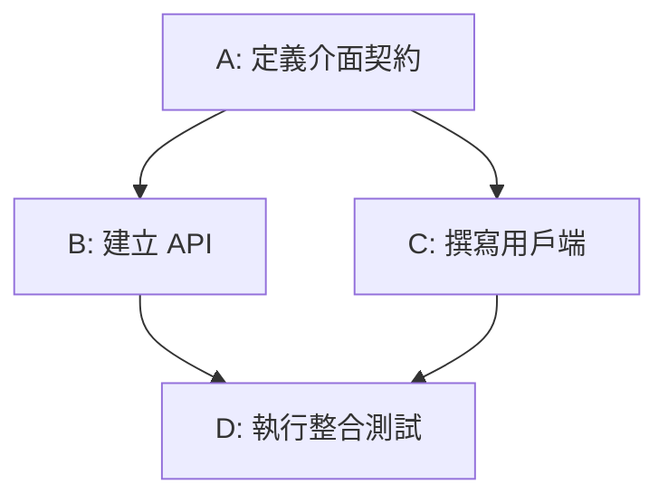

target: coding-harness

# Task dependencies

## When to use

Use this shape for a task plan with parallel prerequisites and a join. An arrow
points from a prerequisite to the task it enables. A join requires all incoming
prerequisites: D can start only after B and C finish. This is not a conditional
choice; use `templates/03-branching-decision.md` when one answer selects a path.

## Table

| Prerequisite | Enabled task | Meaning |
|---|---|---|
| A: 定義介面契約 | B: 建立 API | B waits for A |
| A: 定義介面契約 | C: 撰寫用戶端 | C waits for A; B and C may run in parallel |
| B: 建立 API | D: 執行整合測試 | D waits for B |
| C: 撰寫用戶端 | D: 執行整合測試 | D also waits for C |

## ASCII

A reply defaults to the table above; draw this when the dependency shape itself
is the information, or when the destination does not render markdown. No
generator covers a join. Adapt this diagram and verify it with
`python3 <skill-dir>/scripts/align.py -` (`<skill-dir>` is defined in
`SKILL.md`).

```
A: 定義介面契約
|
+--> B: 建立 API ----+
|                    |
+--> C: 撰寫用戶端 --+--> D: 執行整合測試
```

Both B and C become available after A. The two incoming lines to D mean D
waits for both tasks, not whichever finishes first.

## Mermaid



## Common mistakes

- Drawing B and C in a fixed sequence when they can proceed in parallel.
- Drawing a conditional choice at the split: A enables both tasks.
- Omitting one incoming prerequisite to D or treating the join as an either-or
  decision; D waits for all incoming prerequisites.
- Naming a node only "task" or "done"; each title must stand alone, with a
  body only for distinct detail per `references/node-structure.md`.
