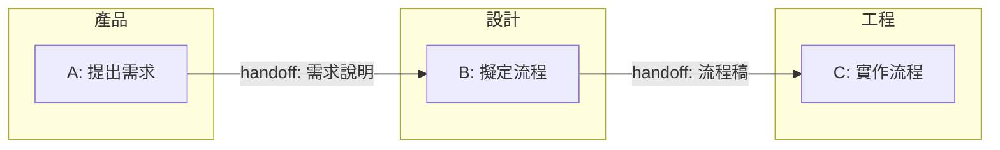

target: coding-harness

# Cross-role workflow

## When to use

Use this shape when the reader must see who performs each work step and what
passes to the next owner. The owner of every step is explicit; an arrow between
owners is a handoff of work or an output. For a message exchange ordered in
time, use `templates/06-actor-sequence.md` instead.

## Table

| Step | Owner | Work | Next handoff |
|---|---|---|---|
| A | 產品 | 提出需求 | 需求說明 to 設計 |
| B | 設計 | 擬定流程 | 流程稿 to 工程 |
| C | 工程 | 實作流程 | Completed work |

## ASCII

A reply defaults to the table above; draw this when ownership and handoffs
are the information, or when the destination does not render markdown. No
generator covers owned work steps. Adapt this diagram and verify it with
`python3 <skill-dir>/scripts/align.py -` (`<skill-dir>` is defined in
`SKILL.md`).

```
[產品] A: 提出需求
       |
       | handoff: 需求說明
       v
[設計] B: 擬定流程
       |
       | handoff: 流程稿
       v
[工程] C: 實作流程
```

Each bracket names the step's owner. The handoff labels name the output that
the next owner receives; they are not extra work steps.

## Mermaid



## Common mistakes

- Showing a message exchange alone instead of the work each role performs;
  use `templates/06-actor-sequence.md` for messages in time order.
- Omitting a step owner or placing a step in the wrong owner's lane.
- Labelling a handoff only "send"; name what the next owner receives.
- Using a vague node title whose body must explain the action; titles stand
  alone, and bodies add only distinct detail per `references/node-structure.md`.
